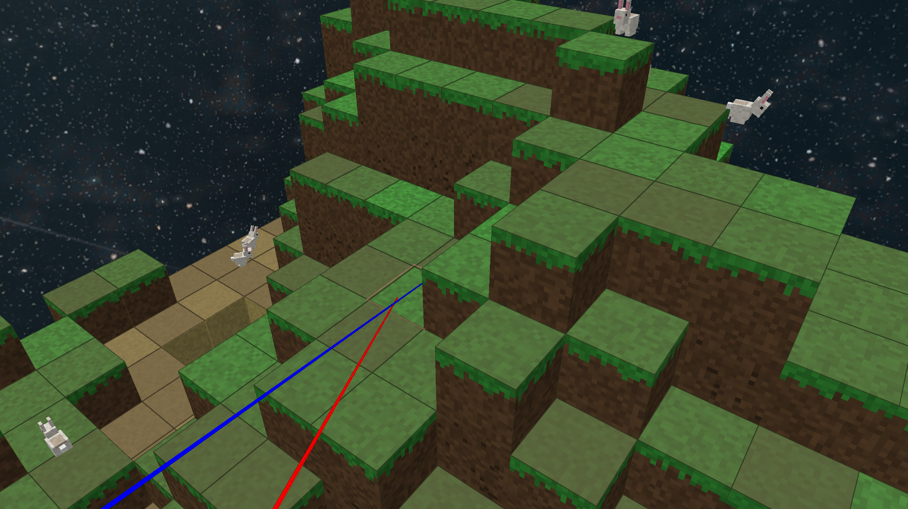
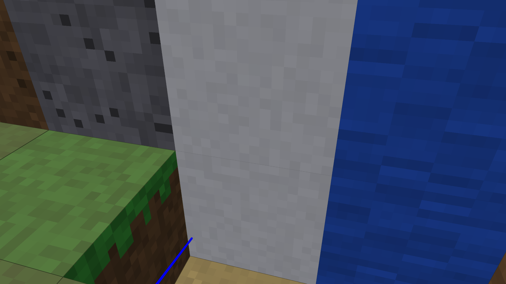
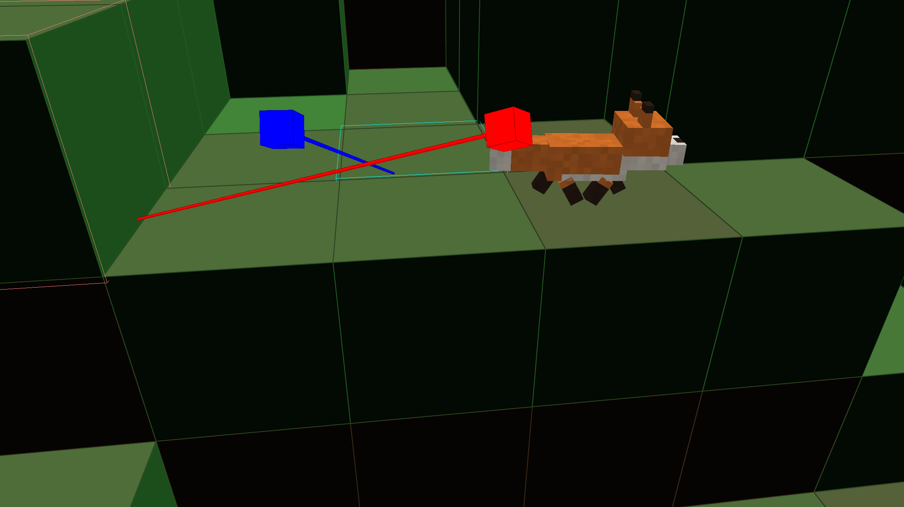
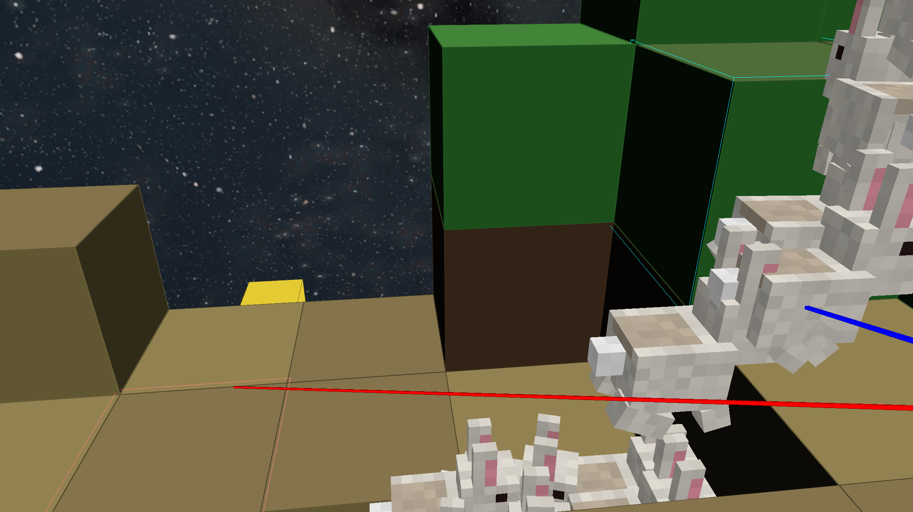
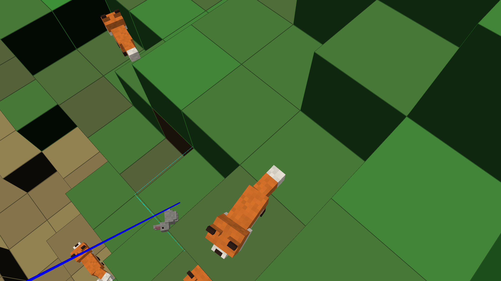

# SWAGameXR

A sandbox game in SqueakXR: procedural terrain you can dig and build in, with
rabbits and foxes living on it and an ecosystem simulation underneath, viewed
either as a board on a table or at one metre per block with you standing in it.
It is one sample application of SqueakXR, developed in XR with the other tools
(workspace, code browser, an AI agent) in the same world.

It is a Squeak package, so **the code is in the image**, not in these files.
`src/` is an export. To read something, open it in the image.

The feature-by-feature documentation is in **[swagame/](swagame/index.md)**:
a slide deck with an outline of the whole game, a reference page per topic
([architecture](swagame/architecture.md), [terrain](swagame/terrain.md),
[chunks](swagame/chunks.md)), a mark set per topic for the Code Map, and a
list of [dead code and polish](swagame/findings.md).

## Seeing it run

In the headset or the desktop world: **B** (either hand, nothing grabbed) ->
**World >** -> **games** -> **SWAGame**. It appears on the floor ahead of you,
yaw snapped to a quarter turn. A new game is 3 x 3 chunks (48 x 48 cells,
`SWAGameXR class>>startChunks`), 2.4 m across at table scale.

From a workspace:

```smalltalk
SWAGameXR openGameIn: SRWorld current.    "the running one, or nil"
SRWorld current avatar locomotionEnabled. "are you walking or flying?"
```

Once a game is open, **B** opens *its* menu rather than the world's: the toggles
(first person, panels, chunk bounds), the tools, and **World >** to get back out.
**Squeeze + B** is the context menu of whatever the hand is holding, so the world
menu is still reachable by grabbing the world.

Tools are **per hand**: the menu opens at one hand, you point at it with the
other, and the hand that picks is the hand that gets the tool. A cube in the
tool's colour rides on that hand. `SRHand class>>sharedTool` is a preference for
anyone who would rather both hands held the same one.

## The shape of it


Four groups, and the figure is worth more than this list:

- **`SWAGameWorld`** -- the simulation. Terrain, mobs, tick. Knows nothing about
  rendering, which is why tests can step a world with no `SRWorld` anywhere.
- **`SWAGame-Voxels`** -- storage. `SWAGameChunkedGrid` maps chunk keys to
  `SWAGameChunk` columns; `SWAGameSpace` owns the cell-to-object mapping;
  `SWAGameBlocks` maps a type id to a colour.
- **`SWAGame-XR`** -- `SWAGameXR` itself, plus picking
  (`SWAGameVoxelCollider`, `SWAGameVoxelRayWalk`), and the animals' looks:
  `SWAGameMobModel` (voxel designs at 1/16 block), `SWAGameMobGait` (heading
  and stride per mob) and `SWAGameMobRenderer` (one draw call per animal; the
  `swagameMob` vertex shader swings the limbs).
- **the panels** -- `SWAGameSlab` and friends, built from `SRObject`s.

## The classes


Position carries the meaning here. **Left of the middle column everything is in
cells; right of it, in metres**, and `SWAGameSpace` is the only crossing. The red
edges end at the *same object*, not at two of a kind:

```smalltalk
xr voxelChunks space == xr space.                             "true"
(xr voxelChunks instVarNamed: 'grid') == xr gameWorld voxels. "true -- no accessor"
```

The mesher reads the simulation's own voxel store, and mesher and mobs share one
mapping. Both identities are asserted by `SWAGameXRMappingTest` -- the second one
after two copies of the conversion drifted and mobs hovered off the ground.

Two other views of the same classes live beside it, both regenerable from the
image rather than drawn by hand (see [figures/index.md](figures/index.md) for how
all of them were made):

| file | what |
|---|---|
| `classes-generated.dot/.pdf` | every class in the package, all state, inheritance only |
| `classes-curated.dot/.pdf` | the same tool, narrowed to a mark set -- the members above |

```smalltalk
"the full one, as the Class Diagram tool draws it"
SWAClassDiagram openOnPackageNamed: 'SWAGame'.

"the narrowed one: mark what matters, then only that shows"
SWAClassDiagram openOnMarks.
```

## Four things that explain most of it

**1. The model does not render, the renderer does not simulate.** `SWAGameXR` is
an `SRObject` that owns a `SWAGameWorld`. Everything in the simulation is in cell
units; everything on the screen is in metres. Confusing the two is the most common
bug in this package.

**2. Terrain is chunked twice, for different reasons.** Storage is 16x16 columns
of 16-cube sections, allocated on first solid write. Meshing is also 16, so a
mesh chunk is exactly a storage section and an empty one is skipped without
looking at a voxel. New chunks are generated by clicking a marker on the floor of
an empty neighbour, and chunks outside `simulationRadiusChunks` freeze.

**3. There is exactly one coordinate mapping, and it is an object.**

```
cell (x y z, y up)  --SWAGameSpace-->  object space (metres)  --globalTransform-->  scene
         |                                                         ^
    chunk key = cell bitShift: -4                            SRAvatar walks here
```

`SWAGameSpace` exists because this conversion was once written out twice.
`SWAGameXRMappingTest` asserts `xr voxelChunks space == xr space` -- identity, so
the copies cannot come back.

**4. Per frame is not per tick.** `step:` runs every frame and interpolates mob
positions; the simulation ticks every `SWAGameWorld>>secondsPerTick` (0.05), which
the renderer derives its period from rather than the reverse; the mesher rebuilds
at most `chunkRebuildBudget` (2) chunks per frame. Three clocks, deliberately.

## The blocks





Block patterns are not textures but code: `SWAGameXR class>>swagameTerrain`
computes a 16 x 16 pixel pattern per block type in the fragment shader. The type
id rides in the vertex colour alpha (`SWAGameBlocks class>>rgbaFor:`), so alpha
there is **not** opacity. The pattern multiplies the block colour from
`SWAGameBlocks class>>types`, so changing a colour there still works, and fades
out when a block pixel gets smaller than a screen pixel, as on the table.

Three preferences (Preference Browser, category **SWAGame**, and the game's
settings menu) switch the looks; they are global, like all preferences here:

| preference | default | off means |
|---|---|---|
| `SWAGameXR blockOutlines` | off | no line round each block face (on: the old 3D grid, `lineThickness` wide) |
| `SWAGameXR blockTextures` | on | every block its plain colour |
| `SWAGameXR animalModels` | on | rabbits and foxes as coloured cubes |

After editing the shader, transpile it and let the game reload it:

```smalltalk
SRShader transpileShaderNamed: #swagameTerrain.
SWAGameXR allInstances do: [:xr |
	xr instVarNamed: 'voxelMeshSRShader' put: nil.
	xr instVarNamed: 'voxelMeshMaterial' put: nil].
```

## The animals







Rabbits and foxes are voxel models at 16 pixels to a block, designed in
`SWAGameMobModel class>>rabbit` and `>>fox`. Each is one mesh, drawn once per
animal; the `swagameMob` vertex shader swings the legs, head and tail from a
per-animal pose, so there are no bones. Rabbits hop, foxes trot in diagonal
pairs, heads go down while eating, and a body lies on its side, darker, shrinking
as it is eaten. The stride follows distance walked, not time, so feet do not
slide. Without the shader (a Quest image with no cached copy) mobs fall back to
plain cubes.

After changing a design: `SWAGameXR allInstances do: [:xr | xr mobRenderer forgetModels]`.

## Walking in it

Walk mode sets `worldScale: 1.0` and switches on `SRAvatar>>locomotionEnabled:`.
The walking itself is **not** in this package -- it is `SRAvatar` and
`SRAvatarBody` in SqueakXR, resolved against any `SRCollisionGeometry`. The game
contributes only `SWAGameVoxelCollider`, which answers "is this box solid" by
sweeping cells.

## Tuning

Species constants are `<preference:>` class variables: 10 on `SWAGameRabbit`,
11 on `SWAGameFox`. They appear in the Preference Browser under **SWAGame**, in
the Morphic `SWAGameConfigPanel`, and in the XR world menu. Changing one affects
**newly created** mobs.

Preferences are global state, so `SWAGameTestCase` nils them in `setUp` and
restores them in `tearDown`. A test that reads a preference tests whatever Jens
last dialled in.

## Gotchas

- **`Vector3` is single precision.** It has produced an off-by-one in a voxel
  lookup three times. A body resting exactly on a cell boundary read back as
  3.99999993 and floored into the block below.
- **An ungenerated chunk is solid.** Walking at the edge of the world feels like
  walking into a wall because it is one.
- **Keep `SWAGameVoxelRayWalk`'s methods small.** As one big method, Cog's ARM64
  JIT miscompiled it and calling it crashed the Quest outright.
- **Rivers are not generated.** Nothing fills the `riverMap` any more, so
  `isRiverAt:` always answers false. It is the seam flowing water would arrive
  through.
- **`SWACube` and `SWAGameCube` are dead** -- no instances, no senders, left from
  before terrain was meshed.

## Tests

48 test methods in `SWAGame-Tests` (`SWAGameMobTest` 21,
`SWAGameXRMappingTest` 15, `SWAGameChunkedGridTest` 12), plus the locomotion ones
on the SqueakXR side. They aim at bugs that actually happened: mobs landing
without sinking, chunk keys round-tripping through negative coordinates, picking
into a grown chunk, feet resting on the column top.

## Further reading

The journal in the sibling `squeak` repo carries the reasoning; these are the
entries that built what is here.

| | |
|---|---|
| `2026-07-29-arm-jit-voxel-collider-crash.md` | why the ray walk is split up |
| `2026-07-30-voxel-chunking-and-the-dirty-flag-race.md` | meshing in chunks |
| `2026-10-15-swagame-from-board-game-to-chunked-world.md` | mobs off the grid, chunked storage, growth in all directions |
| `2026-10-16-walk-mode-and-the-six-bugs-in-the-panels.md` | one block = one metre |
| `2026-10-19b-locomotion-moves-into-the-avatar-...md` | walking became a SqueakXR feature |
