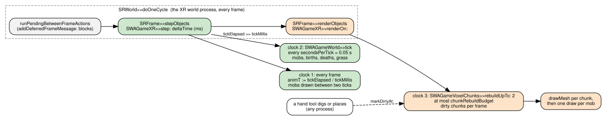

# 1 Architecture and the Frame Loop

[Deck](index.md) | **1 Architecture** | [2 Terrain](terrain.md) | [3 Chunks](chunks.md) | [4 Rendering](rendering.md) | [5 Picking](picking.md) | [6 Editing](editing.md) | [7 Mobs](mobs.md) | [8 Behaviour](behaviour.md) | [9 Ecosystem](ecosystem.md) | [10 Mob Rendering](mob-rendering.md) | [11 First Person](first-person.md) | [12 Panels](panels.md) | [13 Save and Load](save-load.md) | [14 Tests](tests.md) | [15 Findings](findings.md)

Mark set: [marks/01-architecture-and-frame-loop.json](marks/01-architecture-and-frame-loop.json)
-- load it in the Code Map's Marks flap to see every member this page talks about.

## 1.1 What it is

SWAGameXR is a **sandbox game**: blocks to dig and build with, rabbits and
foxes living on them, and an ecosystem simulation underneath. It is **one
sample application** in SqueakXR, and it is meant to be explored and developed
with the other XR tools in the same world: a workspace, a code browser, an AI
agent chat window. If nothing else, it gives the developer a place to stand
while working in XR.

Where it is going (part of Leo's motivation): the developer stands first
person in the immersive block world and talks, by voice or chat, with an AI
agent, and the agent changes the simulation or the world while it runs. Or the
developer opens a workspace and does the same live, by hand.

## 1.2 SqueakXR interfaces used

The game is assembled from SqueakXR's extension points. Several of them were
built because the game needed them first: tools per hand, app menus, walking
on any solid, releasing GPU memory.

| SqueakXR offers | the game uses it as |
|---|---|
| `SRObject>>step:` and `renderOn:` | `SWAGameXR` is one node in the scene graph: it ticks the simulation and draws terrain and animals with raw Raylib calls |
| `<xrMenu:>` pragma | **World > games > SWAGame** (`SWAGameXR class>>xrMenuSpawn:`) |
| `isApp`, `addCustomMenuItemsTo:` | while the game is the active app, **B** opens its menu: settings, scenarios, save and load, tools |
| `SRTool` per hand | `SWAGameDigTool`, `SWAGamePlaceTool`, `SWAGameSpawnTool`, one instance per hand |
| `SRCollisionGeometry` | `SWAGameVoxelCollider`: rays pick voxels, and the avatar walks on the terrain |
| `SRAvatar locomotionEnabled:`, `teleportTo:` | first person: one block is one metre and you stand in it |
| `<shaderSource:>` | `swagameTerrain` (block patterns, grass, outlines) and `swagameMob` (legs, heads, tails) |
| `SRMesh`, `SRTexture`, explicit `unload` | one mesh per terrain chunk, one per animal design, the grass map texture |
| `addDeferredFrameMessage:` | everything GPU-related that starts outside the render process |
| `<preference:>`, preferences in the XR menu | block looks, animal models, simulation radius, all species parameters |
| `SRObject` panels | slabs, the population graph, the mob inspector |

## 1.3 Classes


The bands are layers. **Left of the middle column everything is in cells,
right of it in metres**, and red edges end at the *same object*, not at two of
a kind.

The simulation (`SWAGameWorld`: terrain, mobs, the tick) does not know the
scene. That is a convenience, not the point: tests and balancing runs
(`SWAGameSimulation`) step a world headless, in seconds. `SWAGameXR` reaches
it through `world` (accessor `#gameWorld`, because `SRObject>>world` is already
the `SRWorld` the node lives in).

Two objects are **shared, not copied**, and the tests assert identity:

```smalltalk
xr voxelChunks space == xr space.                             "SWAGameXRMappingTest"
(xr voxelChunks instVarNamed: 'grid') == xr gameWorld voxels.
```

- The **voxel store** (`SWAGameChunkedGrid`) is the simulation's collision
  world and the mesher's input. The game hands its grid to the world
  (`world voxels: gridHandle`); a headless world raises its own
  (`SWAGameWorld>>ensureVoxels`).
- The **mapping** (`SWAGameSpace`) is used by the mesher for vertices and by
  the game for mobs, the avatar, markers and picking. Its `worldScale:` mutates
  the instance in place, because handing either side a new one is exactly the
  drift the class exists to prevent.

## 1.4 Cells and metres

Everything inside `SWAGameWorld` is in **cells**: integer block coordinates,
`y` up, mobs at fractional cell positions. Everything the scene sees is in
**metres**. `SWAGameSpace` is the only crossing:

```
cell (x y z)  --SWAGameSpace-->  object space of SWAGameXR  --globalTransform-->  scene
                vectorForCellX:y:z:                             globalPositionForCellX:y:z:
                cellXForObjectX:  <--                           <-- cellPositionForGlobal:
```

- `originX`/`originZ` are the cells that sit at the object origin: half of the
  original `gridWidth`/`gridDepth`, so the first 3 x 3 chunks are centred under
  the game. They are an origin, **not an extent**; the world grows past them in
  every direction (see [Chunks](chunks.md)).
- `worldScale` is metres per cell: `SWAGameXR class>>tableWorldScale` (5 cm)
  on the table, `1.0` in first person. Changing it remeshes every chunk,
  because vertex positions are baked at this scale.
- Panels are **not** in cells. `panelScale` is a fixed hand-sized unit (the old
  table scale), so scaling the world to 1 m blocks does not produce 2 m buttons
  16 m away.
- A camera or hand is a child of the avatar rig, so the game always asks for
  `globalTranslation`, never `position` (`cellPositionOf:`).

## 1.5 Opening a game

`SWAGameXR class>>xrMenuSpawn:` is the **World > games > SWAGame** menu entry
(an `<xrMenu:>` pragma). The game appears on the floor ahead of the viewer
(`spawnDistance`: half the board plus 70 cm), with its origin at ground level
because the terrain grows up from local `y = 0`. The viewing direction is
flattened first, so looking down does not pull the game closer.

The yaw snaps to **quarter turns**, so the voxel grid stays square to the room.
On top of that comes a half turn, because the game's `+z` and the slab rows run
away from the viewer.

A new game is `startChunks` x `startChunks` = 3 x 3 chunks = 48 x 48 cells,
2.4 m across at table scale. `SWAGameXR` answers `isApp`, so while it is the
active app, **B** opens *its* menu (see the SqueakXR deck, "Tools per Hand,
Apps with Their Own Menu").

## 1.6 Frame loop and update rates



`SRWorld>>doOneCycle` runs, in this order: the deferred frame messages
(`runPendingBetweenFrameActions`), `step:` on every stepped object, then
rendering. `deltaTime` arrives in **milliseconds**, as a Fraction.

**Clock 1, every frame: `SWAGameXR>>step:`.** Accumulates `tickElapsed` and sets
`animT`, the position between the last two ticks (0 to 1) at which mobs are
drawn. `animT` is a Float on purpose: it is read once per mob per frame, and
Fraction arithmetic there is not free. Hand targets are updated here too, even
while paused, because the highlight has to follow the hand.

**Clock 2, every 0.05 s: `SWAGameWorld>>tick`.** Rebuild the neighbour
indexes, step the mobs chunk by chunk, move mobs that crossed a chunk border,
remove the gone, add the newborn, regrow grass. The period belongs to the
world (`secondsPerTick`), and `SWAGameXR` derives `tickMillis` from it, not
the reverse, because mob physics integrates against it. All rates in the
simulation are *per second* and scaled by the period, so changing the period
changes smoothness and cost, not how fast anything lives. A long frame runs at
most **one** tick (`tickElapsed` is capped at one period), so a hitch does not
queue up a burst of catch-up ticks.

Around each tick `SWAGameXR` prepares the interpolation:

1. `snapshotMobPositions`: where every mob is *before* the tick, keyed by mob,
   not by index, because deaths shift the entries. The dictionary is emptied
   rather than replaced, so it does not keep dead mobs alive.
2. `world tick`.
3. `buildMobAnimationData`: one render entry (`SWAGameMobEntry`) per living
   mob and per body: the mob, `from`/`to` positions, colours, energy, remains,
   gait.
4. `advanceGaits`: legs move only when the simulation did.

**Clock 3, at most two chunks per frame: the mesher.** Rendering starts with
`SWAGameVoxelChunks>>rebuildUpTo: chunkRebuildBudget`. An edit only marks its
chunk dirty; the render loop decides when to pay. Why this matters more than
making the mesher faster is on the [Chunks](chunks.md) page.

The three rates are independent: the frame rate affects smoothness, the tick
rate affects cost, and the mesh may lag an edit by a few frames. The collider
reads the voxel store directly, never the mesh, so the lag is only visible and
never felt.

## 1.7 Rendering and per-frame allocation

`SWAGameXR>>renderOn:` issues raw Raylib calls rather than building
`SRObject`s per block or per mob:

1. **Terrain first**: `renderTerrainMeshOn:` remeshes within the budget,
   sets the terrain uniforms (outline width, block textures, grass map) and
   calls `drawMesh` once per non-empty chunk. The transform and the Raylib
   material are computed once for all chunks. Terrain must come before
   anything that pushes a matrix, because `drawMesh` *replaces* the current
   matrix.
2. Optionally the chunk bounds (red wire boxes).
3. **Animals**: `SWAGameMobRenderer` draws one mesh per animal when
   `SWAGameXR animalModels` is on and the `swagameMob` shader is available.
   Otherwise each mob is a coloured cube.
4. Under the game's own transform: the hand-target wire boxes, the selection
   highlight, energy and age bars.

**Allocation is a design constraint here.** This code runs at 90 to 300 frames
a second inside a garbage-collected image, so the per-frame path allocates
nothing it can avoid:

- `ensureRlScratch`: `RlVector3`, `RlColor` and `RlMatrix` structs are owned and
  refilled. Allocating one costs about 1 KB (it goes through
  `ExternalType structTypeNamed:`); refilling costs about 5 bytes. Each field is
  guarded separately, so an instance that ran an older version of the method
  still gets the fields added later.
- `rlColorsForMobColor:` caches colour pairs in a flat Array, scanned linearly.
  A Dictionary lookup would need an `ifAbsent:` block, which costs about
  224 bytes per call here because it materialises the method context.
- Mob render entries (`SWAGameMobEntry`) are reused across ticks and refilled
  by `setMob:from:to:...`. A fresh one per mob per tick is young while the game
  is old, so every one of them would add a remembered-set entry that no
  scavenge can clear. The same goes for their vectors: an entry owns `from`,
  `to` and `position` and only changes their contents (`setPosition:`).
  `positionAt: t` answers the same refilled `position` every frame, and
  `RlVector3>>setPosition:` copies it into the raylib struct.
- `updateHandTargets` writes `nil` into its dictionary slot instead of
  removing it, so the dictionary is allocated once.

## 1.8 Processes and the GPU

GL belongs to the render process. Anything that reaches the GPU from a menu
action, the MCP server or a workspace goes through
`SRWorld>>addDeferredFrameMessage:` and runs between two frames:

- `adoptWorld:` (loading a saved game) swaps grid, mapping, meshes and mob
  entries in one deferred block, so the renderer never draws half of each game.
- `remove` (the context menu's Remove) takes the panels down and calls
  `releaseGpuResources`, which unloads chunk meshes, mob meshes and the grass
  texture in a deferred block. Panels are world children, not game children,
  so nothing else would remove them.
- `SWAGameVoxelChunks>>retireAllMeshes` parks old meshes; the next
  `rebuildUpTo:`, which runs in the render process, unloads them.
- `onCacheInvalidated` (after an image restart the GL context is new) drops
  the uploaded meshes and textures so they upload again.

Other process rules:

- Each `SWAGameWorld` owns its `Random`. `Random` is not reentrant, and a
  class-side stream shared by the live game and a headless test world crashed
  the render loop.
- The terrain shader is transpiled from GLSL 450 on the desktop. On the Quest
  there is no glslang/spirv-cross, so the transpiled code must already be in
  the `ShaderCache` that ships with the image; without it the terrain falls
  back to a plain `SRMaterial`.

## 1.9 Where to look next

| for | read |
|---|---|
| every member of this page, generated from the mark set | [figures/01-architecture-and-frame-loop.svg](figures/01-architecture-and-frame-loop.svg) |
| how terrain is made | [Terrain](terrain.md) |
| why the mesher is chunked, and how | [Chunks](chunks.md) |
| what does not hold up | [Findings](findings.md) |
