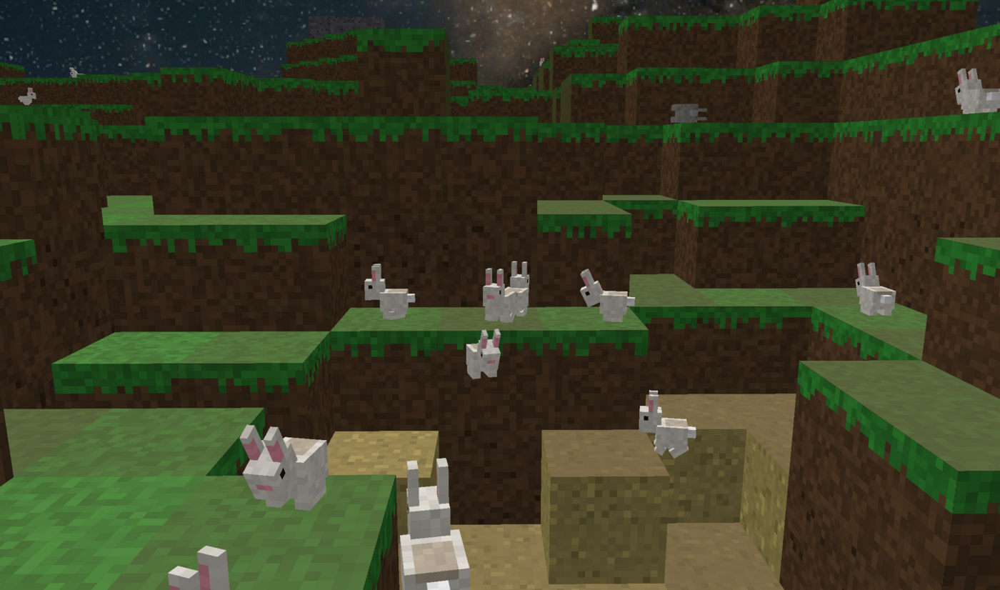

# 8 Behaviour: Deciding, Routing, Eating, Resting

[Deck](index.md) | [1 Architecture](architecture.md) | [2 Terrain](terrain.md) | [3 Chunks](chunks.md) | [4 Rendering](rendering.md) | [5 Picking](picking.md) | [6 Editing](editing.md) | [7 Mobs](mobs.md) | **8 Behaviour** | [9 Ecosystem](ecosystem.md) | [10 Mob Rendering](mob-rendering.md) | [11 First Person](first-person.md) | [12 Panels](panels.md) | [13 Save and Load](save-load.md) | [14 Tests](tests.md) | [15 Findings](findings.md)

Mark set: [marks/08-behaviour.json](marks/08-behaviour.json)



The intended behaviour: mobs wander, graze, pause, react to a fox during a
meal, and do not get stuck at cliffs. Most of the rules below were found by
observing the game, in the headset and on the desktop, and correcting what
looked wrong.

## 8.1 Decision loop

`SWAGameMob>>reconsiderOn:` runs every tick, but decides only every
`decisionInterval` (0.25 s). It asks the mob's `movementStrategy` two things:

1. **`alarmsFor:on:`**, cheap, every decision: is something worth running for
   (a fox for a rabbit, prey for a hungry fox)?
   - Yes: the mob is `alarmed`, stops eating, replans with `nextRouteFor:on:`
     and runs at `runSpeed`.
   - It was alarmed and no longer is: it stops and rests.
2. Otherwise the mob is **calm** and **keeps its plan**. Only when it has
   nowhere to go and its rest is over does it ask `nextRouteFor:on:` for a new
   route, and it walks at `walkSpeed`.

Deciding on a timer, not only on arrival, is what lets a fox track a moving
rabbit and a rabbit notice a fox mid-journey, mid-rest or mid-meal. Keeping the
calm plan is what stopped the zigzag: re-picking a jittered grazing spot four
times a second made every herd shuffle on the spot.

## 8.2 Strategies

A strategy (`SWAGameMoveStrategy`) answers a **route**: waypoints as Points of
`x @ z`, or nil to stay put. Species are named by symbol (`#fox`, `#rabbit`),
so no strategy mentions a mob class, and strategies nest:

| mob | strategy | when calm, or nothing found |
|---|---|---|
| rabbit | `SWAGameFleeStrategy` (threat `#fox`, `detectionRange` 6) | `SWAGameGrazeStrategy`, which falls back to `SWAGameWanderStrategy` |
| fox | `SWAGameHuntStrategy` (prey `#rabbit`, `detectionRange` 8), only while hungry | `SWAGameWanderStrategy` |

- **Wander**: a random cell 2 to 6 cells away that can actually be walked to,
  six tries, each one A* search with at most 40 expansions. Never a cell in an
  ungenerated chunk. Flooding the neighbourhood first and choosing from it cost
  3.7 ms per call, for a choice that is random anyway; the random tries cost
  0.15 ms.
- **Graze**: the richest grass within 4 cells, scored by **path length**, not
  straight distance, so grass on a ledge does not draw the herd to the foot of
  the cliff. Scores are **jittered** (times 0.5 to 1.5): without it every grazer
  in earshot picked the same cell and the herd piled onto one block.
- **Flee**: the reachable cell furthest from the nearest fox, searched within 5
  cells and **never through the cells next to the fox**. Running straight away
  sent rabbits into walls and up against cliffs, where they waited to be eaten.
  A route that still leads away is kept rather than searched afresh; replanning
  for a whole herd under attack every decision was the largest cost per tick.
- **Hunt**: a route to the nearest prey that can be reached; only the nearest
  two are tried, since each is a search and this runs four times a second. A
  rabbit up on a ledge is passed over instead of being stared at from below.
  A body counts as prey: the same meal without the chase.

`detectionRange` is a preference per species and lives on the strategy, which
does the sensing. Strategies that sense nothing accept it anyway, because the
preference setter reaches every mob of a species.

## 8.3 Routing: `SWAGameNavigator`

Walking straight at a target jammed mobs against any rise of two blocks, where
they jumped in place for ever. The navigator routes over the terrain **as a mob
can walk it**:

- A **node** is a cell a mob can stand in, packed into one SmallInteger
  (`keyX:y:z:`), so the searches key Dictionaries without allocating.
- **Neighbours** (`neighboursOf:do:`): the four sides, **up one block** if there
  is headroom above the mob for the jump, **down at most three** (`maxDrop`).
  Falling is harmless, but a mob that drops into a pit it cannot climb out of
  has nowhere left to go. **Diagonals only across flat ground**: cutting a
  corner at a step clips the block on the corner and stalls the mob.
- `nodeFor:` is the cell under the mob's feet, falling to the ground first if
  it is in mid-jump.
- Two searches: breadth first within a radius (`reachFrom:radius:unless:`,
  answers node -> {parent. steps}; used by graze and flee, which want to choose
  among everything reachable) and A* to one column (`routeFrom:toX:z:limit:`,
  used by wander and hunt, which know where they want to go).

Routes ignore other mobs and water.

## 8.4 Steering and stuck detection

`steerTowardTargetOn:` heads for the first waypoint of the route at the
current speed; within a quarter cell it moves on to the next. On the last one
the mob stops.

`isStuckAt:on:` watches **progress, not position**: if the distance to the
waypoint has not shrunk by 0.1 cells for `patience` (1.5 s), the mob gives up
and rests, then replans. A replan that heads for the same next cell keeps the
progress record, or a chase replanning every 0.25 s could never be found
stuck. Nothing to walk to counts as arriving too, or a mob boxed into a pit
would search the terrain four times a second.

## 8.5 Resting

Without a pause after arriving every animal is in constant motion. `stopOn:` rests a calm mob for a random time up
to `restTime` (rabbit 4 s, fox 6 s). A threat still interrupts the rest.

The exception is a **hungry fox**: it does not rest at all
(`SWAGameFox>>restAfterArrivingOn:`). Resting between short ambles, foxes on a
sparse world covered so little ground that they starved without ever seeing a
rabbit; several balancing runs lost all foxes at about 187 s, exactly how long
a fox lasts without eating.

## 8.6 Eating

**Rabbits** (`SWAGameRabbit>>actOn:`, `grazeOn:`) start a meal only when
idle: arrived, calm, not full, on a tile with grass. Starting one on every tuft
passed on the way turned a walk into a string of meals. A meal lasts `eatTime`
(3 s), standing still, with the energy (`eatGain`, 6) arriving as it is eaten.
At the end the tile is cropped to 0. Two rabbits can share a tile; the one
finishing first leaves the other nothing to finish.

**Foxes** (`SWAGameFox>>actOn:`, `feedOn:`) hunt only while **hungry**, below
35 % of `maxEnergy`. Without that, predation was limited only by how many
rabbits a fox could reach, not by what it needed, and the prey was wiped out.
The fraction has to sit well below where a meal leaves a fox, or it is hungry
again a second after eating. A hungry fox takes a body lying within reach
before it kills; otherwise it kills a rabbit within `huntRadius` (at least 0.7
cells: with continuous positions an exact match never happens), and the kill
is tallied as *eaten*. Killing is instant, eating is not: the fox stands over
the body, gaining `eatGain` (35) times the rabbit's `weight` in proportion to
the remains it consumes. A rabbit puts on weight until half its lifespan
([Mobs](mobs.md)), and the meal is scaled with it: a full-grown rabbit takes
`eatTime` (8 s), a newborn (weight 0.1) a tenth of it, 0.8 s for 3.5 energy.
The energy arrives at the same rate either way.

## 8.7 Cost

Measured on the live world when routing came in, with 116 foxes: 8 ms per
tick. After the November speed-ups a tick is about 36 µs per mob. The rules for
staying cheap are in the methods: alarm checks are cheap and run every
decision, searches run only when a plan is needed, flee routes are reused,
hunts try two prey, wander tries random cells instead of flooding.

## 8.8 Inspecting

The **mob inspector** (click a mob with a bare hand) shows a mob's state live;
the energy and age bars are in the game's settings menu. From a workspace:

```smalltalk
| gw fox |
gw := (SWAGameXR allInstances detect: [:x | x world notNil]) gameWorld.
fox := (gw mobsOfSpecies: #fox) first.
{fox isHungry. fox alarmed. fox isEating. fox route}.
```
