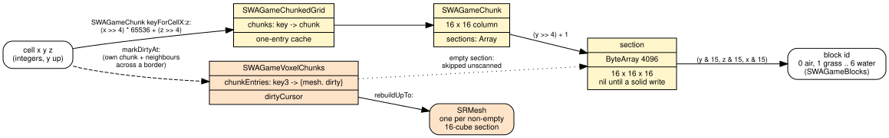
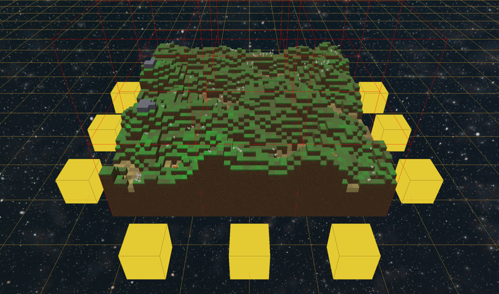

# 3 Chunks: Storage, Meshing, Growth, Simulation

[Deck](index.md) | [1 Architecture](architecture.md) | [2 Terrain](terrain.md) | **3 Chunks** | [4 Rendering](rendering.md) | [5 Picking](picking.md) | [6 Editing](editing.md) | [7 Mobs](mobs.md) | [8 Behaviour](behaviour.md) | [9 Ecosystem](ecosystem.md) | [10 Mob Rendering](mob-rendering.md) | [11 First Person](first-person.md) | [12 Panels](panels.md) | [13 Save and Load](save-load.md) | [14 Tests](tests.md) | [15 Findings](findings.md)

Mark set: [marks/03-chunks.json](marks/03-chunks.json)

The world is cut into 16 x 16 columns, the **chunks**. Four separate things
use that cut: storage, meshing, growing the world, and how much of it is
simulated. They agree on the size (16, `SWAGameChunk class>>size`), so a mob,
the blocks under it and the mesh that shows them are in the same chunk.





## 3.1 Motivation

The voxel store is the *authoritative* state; the GPU mesh is *derived* from
it. With one mesh for the world, a one-block edit remeshed all of it: change
O(1), recomputation O(world). Chunking closes that gap, and it is only legal
because the derivation is **local**: whether a block shows a face depends on
the block and its six neighbours, nothing else. A dependency radius of one is
what allows meshing each chunk on its own. It is also why an edit on a chunk
border dirties the neighbour as well (the *halo*).

The bigger win was not less work but **divisible** work. The same full remesh
measured 54 ms on an idle image and 292 ms with the render loop running: an
indivisible job cannot use a frame's slack, it overruns and is descheduled.
Small jobs, two per frame, cause no visible frame drops. The full reasoning, including the
`(n + 2)^3` cost model and why the consumer (draw calls) rather than the
mesher sets the chunk size, is in the journal:
`squeak/journal/2026-07-30b-chunking-conceptually.md`.

## 3.2 Storage

**`SWAGameChunk`** is one 16 x 16 column, split vertically into 16-cube
**sections** (`sectionHeight`). A section is a 4096-byte `ByteArray` of block
ids, allocated on the first *solid* write into it; writing air into a missing
section allocates nothing. A 32-high store has two sections per column. The
sky above the terrain costs nothing.

**`SWAGameChunkedGrid`** maps chunk keys to columns and answers the voxel
protocol everyone uses: `at:at:at:`, `at:at:at:put:`,
`hasBlocksInSectionAtX:y:z:`, `chunkColumnsDo:`.

- **Keys** are SmallIntegers, `cx * 65536 + cz` (`SWAGameChunk class>>keyX:z:`),
  because a Point would allocate on every voxel lookup. A negative `cz` borrows
  from the `cx` half; that is harmless as long as the decoders (`xOfKey:`,
  `zOfKey:`) read `cz` from the same signed window, `minCoordinate` to
  `maxCoordinate`. This packing kept the keys of worlds saved before negative
  chunks existed valid.
- **Cell to chunk** is `bitShift: -4`, an arithmetic shift, which floors for
  negative cells as `//` would. Inside a chunk the local coordinates are
  `bitAnd: 15`. The shifts and masks assume both sizes are 16.
- **A one-entry cache** (`cachedKey`, `cachedChunk`): meshing, collision and
  the ray walk all sweep within one column before moving on, so most lookups
  are a single compare.
- Coordinates are **truncated on entry**: raycast hits arrive as Floats.
- **Bounds**: height is a real limit. Horizontally the only limit is the range
  the key can still tell apart (`isValidHorizontal:`); beyond it two chunks
  would share a key. Outside the store, and in unallocated chunks, `at:at:at:`
  answers 0, air.

Measured when this replaced the flat Array: reads are about 2.7 times slower
(the shifts and masks brought it down from 3.1), the price of a world without
a fixed extent.

## 3.3 Meshing

**`SWAGameVoxelChunks`** owns one `SRMesh` per non-empty 16-cube. A mesh chunk
is exactly one storage section, so an empty section is dismissed without
looking at a single voxel (`buildChunkX:y:z:` asks
`hasBlocksInSectionAtX:y:z:` first).

- **Face culling**: a face is emitted where a solid block meets air. The
  neighbour lookups deliberately reach across the chunk border; that is what
  makes the seams invisible.
- **Two passes**: count the visible faces, allocate the raw arrays exactly,
  then write. Arrays are indexed by element, not by byte.
- **One object space**: vertices are written through the shared
  `SWAGameSpace`, so all chunk meshes share one transform and one material and
  are drawn in a single loop (see [Architecture](architecture.md)).
- **Texcoords run 0 to 1 per face**: the `swagameTerrain` fragment shader turns
  them into a distance-to-border field and draws the block outline from it.
  There is no edge geometry anywhere.
- **The 16-bit index limit** decides the maximum chunk size
  (`maxChunkSizeForIndices`, 17). The worst case is not a solid block, which
  shows no inner faces, but a **checkerboard**: half the voxels solid, none
  touching, each showing six faces, `12 n^3` vertices. A 16-cube needs at most
  49,152.

### 3.3.1 Dirty tracking

Each mesh chunk has an entry `{mesh. dirty}` in `chunkEntries`, keyed by
`keyForChunkX:y:z:`.

- An edit calls `markDirtyAt:`. It marks the voxel's own chunk and, for every
  chunk border the voxel lies on, the neighbour across it: up to four chunks
  for a corner voxel. That is the halo, the dependency radius made visible.
- `rebuildUpTo: budget` runs in the render process, at most
  `SWAGameXR>>chunkRebuildBudget` (2) chunks per frame, round robin from
  `dirtyCursor` so no chunk can starve.
- Edits arrive from other processes (menus, the MCP server, tools) and can
  preempt a rebuild at any bytecode. So **every transition is one store**:
  marking writes `true` into slot 2 of an entry that already exists. And the
  flag is **cleared before meshing**, not after: a mark that lands
  mid-rebuild then survives into the next frame. Worst case a redundant
  rebuild, never a lost one.
- The first design, a FIFO queue plus a "queued" flag, could lose a chunk
  forever under exactly that interleaving: dirty, unqueued, and impossible to
  queue again.
- Old meshes are *retired*, not unloaded: a reset can come from a menu, and
  GL belongs to the render process. The next `rebuildUpTo:` unloads them.

The mesh therefore *converges* to the voxel store within
`ceiling(dirty / budget)` frames. That is safe because nothing interactive
reads the mesh: picking (`SWAGameVoxelCollider`) and mob physics read the
voxel store directly, so only the rendered image can lag behind an edit.

## 3.4 Growing the world

A new game generates 3 x 3 chunks. After that, the world grows by hand:

- `SWAGameWorld>>generatedChunks` is the set of chunk keys that exist.
- `SWAGameXR>>candidateChunkKeys` are the ungenerated chunks orthogonally next
  to a generated one, so the world grows outwards from what exists rather than
  in islands.
- `refreshChunkMarkers` stands a yellow **Generate** button (`SWAGameButton`)
  on the floor in the middle of each candidate. Its size grows with the world
  scale, capped at 120 cm, so it stays reachable in first person. Grabbing a
  marker grabs the game (`grabTarget:`), whose context menu then opens; the
  marker itself does not come off its chunk.
- Clicking one runs `SWAGameXR>>generateChunkAtX:z:`: heights and grass
  (`SWAGameWorld>>generateChunkAtX:z:`), the voxels, a starting population of
  five rabbits and a fox (`spawnMobsInChunkX:z:`), and new markers. The
  markers are rebuilt wholesale, since one generation both consumes a marker
  and exposes new ones.
- `startFromSingleChunk` resets to one chunk, for growing a world from scratch.

**An ungenerated chunk counts as solid.** `SWAGameWorld>>isSolidAtX:y:z:` answers
true there (and below the store; above it is open). Mobs stay on terrain that
exists, wandering never picks a target inside an ungenerated chunk
(`isCellGeneratedX:z:`, asked by `SWAGameWanderStrategy`), and the avatar,
which walks against the same collider, is stopped at the edge of the world.

Picking grows along: `SWAGameXR>>marchBounds` is the box a picking ray may
march, computed from the generated chunks, not from `gridWidth`.

## 3.5 Mob storage per chunk

`SWAGameWorld` has no list of mobs. **`mobChunks`** (chunk key to bucket) is
the only storage; `mobsDo:` walks the buckets and `mobs` builds a snapshot.
With a single store, a mob can no longer be drawn but never simulated, which
is what two parallel views once produced.

- A mob remembers its `chunkKey`. `migrateMobsBetweenChunks` compares and
  moves only the mobs that actually crossed a border, so a settled herd costs
  nothing.
- New mobs come in through `addMobNow:` outside a tick and through the
  newborn queue inside one; both end in `placeMobInChunk:`.
- The neighbour index for separation and hunting is keyed per cell
  (`cellKeyForX:z:`), with `cellZ` biased by 2^19 because a plain `x * n + z`
  borrows from `x` once `z` is negative.

## 3.6 Simulation radius

`tick` steps the mobs **per active chunk**. `activeChunkKeys` is every
generated chunk, or, with a radius, the square of chunks within
`simulationRadiusChunks` of the player:

- The preference `SWAGameXR class>>simulationRadiusChunks` (category SWAGame).
  0, the default, simulates everything: the starting world is only three
  chunks across, and any radius would freeze part of it.
- `updateSimulationCentre` converts the camera position through the shared
  space every tick, so the centre is in the same cells the chunks are keyed by.
- Outside the radius, chunks **freeze**: no mob steps, no grass grows, and
  their mobs are left out of the neighbour indexes, so a frozen mob is neither
  prey, nor threat, nor obstacle.

Measured when it was introduced (64-cell world, radius 1, 4 of 16 chunks):
tick 767 ms to 374 ms. The rest was grass regrowth scanning every cell; it now
runs per active chunk too.

## 3.7 Inspecting a running game

```smalltalk
| xr |
xr := SWAGameXR allInstances detect: [:each | each world notNil].
xr gameWorld generatedChunks size.   "9 on 2026-11-02"
xr gameWorld voxels stats.           "chunks 10, sections 10, blockBytes 40960"
xr voxelChunks stats.                "chunks 20, drawnChunks 10, vertices 36392, triangles 18196"
xr toggleChunkBounds.                "red wire boxes, see Findings for their limit"
```

## 3.8 Known limits

All in [Findings](findings.md): the mesher's own key has a much smaller
horizontal window than the storage key; generating one chunk remeshes the
whole world; and several features (chunk bounds, grass shading, height sync
after digging) still stop at the original 48 x 48 area.
