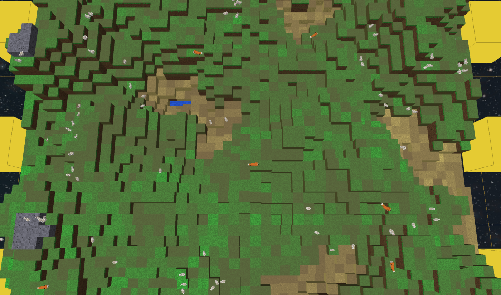

# 9 Ecosystem: Grass, Breeding, Balance, Scenarios

[Deck](index.md) | [1 Architecture](architecture.md) | [2 Terrain](terrain.md) | [3 Chunks](chunks.md) | [4 Rendering](rendering.md) | [5 Picking](picking.md) | [6 Editing](editing.md) | [7 Mobs](mobs.md) | [8 Behaviour](behaviour.md) | **9 Ecosystem** | [10 Mob Rendering](mob-rendering.md) | [11 First Person](first-person.md) | [12 Panels](panels.md) | [13 Save and Load](save-load.md) | [14 Tests](tests.md) | [15 Findings](findings.md)

Mark set: [marks/09-ecosystem.json](marks/09-ecosystem.json)



Three levels: **grass** feeds rabbits, **rabbits** feed foxes, and **foxes**
are limited by food and by territory. Every number is a preference, every game
can carry its own tuning, and the whole thing can run headless to see where a
tuning leads.

## 9.1 Grass

- Grassland is the elevation band where grass grows ([Terrain](terrain.md)).
  A new chunk starts with every grassland tile at the maximum, 10.
- A rabbit's meal crops its tile to **0**. The level does not change how much
  a meal gives (always `eatGain`); it steers which tile the graze strategy
  picks, and how green the tile is drawn.
- **Regrowth** (`SWAGameWorld>>regrowGrass`): every tile has the same chance per
  second, `grassRegrowthPerSecond` (0.015), to grow one level. Instead of a dice
  roll for all 256 tiles of a chunk per tick, each active chunk draws the
  *expected* number of events (under one per tick at the usual rates) and picks
  tiles at random: the same chance per tile, about a hundredth of the cost. A
  cropped tile grows back only on grassland.
- This rate is what **caps the rabbits**. A rabbit needs `burnRate / eatGain`
  meals per second (0.1 at the defaults), and the pasture produces about
  `tiles × grassRegrowthPerSecond` edible tiles per second, so it feeds roughly
  `tiles × 0.015 / 0.1` rabbits, and no more.
- Grass is drawn by the terrain shader from a grass-map texture: grazed ground
  fades towards bare earth and grows back to the terrain colour.

## 9.2 Breeding

`canReproduceOn:` is asked every tick of a living mob:

- energy above `reproduceThreshold`, and
- a dice roll: `reproduceChance` is **percent per second**, scaled by the tick, and
- for foxes, **territory** (`hasTerritoryOn:`): no other fox within
  `territoryRadius` (6) cells. Checked last, because it scans the foxes and the
  dice usually say no first.

The parent pays `reproduceCost`; the young starts at `offspringEnergy` on the
parent's spot (the push of separation, [7.4](mobs.md) moves it off).

Two constraints that are easy to break by tuning:

- **The fox threshold must stay under where a meal leaves a hungry fox.** A fox
  is hungry under 70 (35 % of 200), a rabbit gives 35 over 8 s while the fox
  burns 0.8/s, so a meal ends near 98. With the threshold at 100 foxes never
  bred at all; it is 90. That holds for a **full-grown** rabbit only: since
  meals scale with the prey's weight, a fox living on young rabbits may not
  get over the threshold. Not yet re-balanced.
- **The rabbit run speed must stay under the fox's** (2.6 against 3.0), or no
  hunt is ever won.

## 9.3 Starting population

`spawnMobs` scales with the area: about 32 rabbits and 3 foxes per 64 x 64
cells, at least 4 and 1, so roughly **ten rabbits per fox**, near where the
populations settle. At 5 to 2 a 32-cell world lost its rabbits to the first
hunts in most runs; a handful of mobs goes extinct on a run of bad luck rather
than from predation. A chunk generated later gets 5 rabbits and 1 fox
(`spawnMobsInChunkX:z:`).

## 9.4 The defaults (Balanced)

| parameter | rabbit | fox | unit |
|---|---|---|---|
| walkSpeed / runSpeed | 0.6 / 2.6 | 0.7 / 3.0 | cells per second |
| detectionRange | 6 | 8 | cells |
| burnRate | 0.6 | 0.8 | energy per second |
| eatGain / eatTime | 6 / 3 | 35 / 8 | energy / seconds per meal |
| maxEnergy / startingEnergy | 80 / 40 | 200 / 150 | energy |
| reproduceThreshold / Cost / Chance | 55 / 20 / 2 | 90 / 60 / 1 | energy / energy / % per second |
| offspringEnergy | 25 | 50 | energy |
| restTime | 4 | 6 | seconds, the longest pause |
| lifespan | 300 | 600 | seconds; child for the first 20 %, grown at 50 % (weight 0.1 at birth) |
| huntRadius / territoryRadius | | 1 / 6 | cells |
| grassRegrowthPerSecond (world) | | | 0.015 per tile and second |

The rabbit's `detectionRange` is short on purpose: a fleeing rabbit does not
eat. At 14 on a 32-cell world a fox was almost always in sight, and the herd
starved faster than the foxes could ever have eaten it.

## 9.5 Image defaults and per-game parameters

**Image defaults** are `<preference:>` class methods on `SWAGameRabbit`,
`SWAGameFox` and `SWAGameWorld` (category *SWAGame*): in the Preference
Browser, the Morphic `SWAGameConfigPanel`, and the XR preferences menu. The
default value is the one behind `ifNil:` in the getter.

**Per game**: `SWAGameWorld>>config` holds only what a game sets itself;
`parameter:of:` falls back to the image preference. So two games can run
different tunings side by side, and a game that sets nothing follows the image.

- Mobs take the game's values when they join (`configureMob:`), and again when
  the game's config or the image defaults change (`reconfigureMobs`,
  `SWAGameMob class>>defaultsChanged`). Only parameters change, never energy.
- Changing an image default reaches **every** game that does not override it.
- A saved game stores its config.

## 9.6 Scenarios

`SWAGameScenario` is a named set of values for all those preferences, so a
demo can switch tunings in one click. In XR: the game's menu, **Scenarios >**,
with `[active]` on the one in force, an **Image defaults** row, and **Save
current**.

| scenario | what it shows (20 min, fresh worlds, 2026-11-02) |
|---|---|
| Balanced | steady at 32, 48 and 64 cells |
| Nature documentary | Balanced at half the pace, every rate together; steady |
| Old fast pace | the tuning from before walking and running were split, for comparison |
| Rabbit plague | the foxes die within minutes, by design |
| Fox paradise | far-sighted, faster foxes: a boom that collapses on small worlds |
| Boom and bust | efficient foxes on a fast pasture: big swings, survives 20 minutes |

- Built-ins are code and state **only what differs** from the defaults
  (`named:overriding:`), so a changed default reaches all of them.
- The parameters are found through the `<preference:>` pragmas
  (`parametersOf:`): a new numeric preference is saved and switched without
  being listed anywhere.
- The defaults are read from the getters by clearing the backing class
  variables for an unpreempted moment (`defaultValues`), so no number is
  written twice.
- Saved scenarios are JSON in `swagame-scenarios/` beside the image, keys
  sorted, so re-saving an unchanged one is no diff in git and the other images
  get them by pulling.
- In the game menu a scenario applies **to that game**. `SWAGameScenario>>apply`
  sets the image defaults instead (the Morphic config panel uses it); it writes
  the class variables directly and tells the games once, because going through
  every setter reconfigured every mob of every world each time.

## 9.7 Headless simulation

`SWAGameSimulation` runs a game **without rendering**, from a detached copy
of a world (through the saved form, so it is exactly what loading a save gives)
with a scenario applied. Simulated time runs at the game's own tick period, so
it plays out as on screen, only as fast as the machine allows: 30 simulated
minutes of a 64-cell world take about 20 s.

```smalltalk
"From the running game, several scenarios, below the tools:"
SWAGameSimulation
	compareInBackground: SWAGameScenario builtIns
	from: (SWAGameXR allInstances detect: [:x | x world notNil]) gameWorld
	seconds: 600.
SWAGameSimulation lastReport.        "poll in a later doit"

"Fresh worlds of several sizes, replicated:"
SWAGameSimulation sweep: {SWAGameScenario balanced} sizes: #(32 48) replicates: 3 seconds: 1200.
SWAGameSimulation sweepLog.          "one line per run, readable while it runs"
```

Each run samples rabbits, foxes and bodies every 30 simulated seconds and
gives a **verdict** over the second half: `collapse` (the rabbits died, the
foxes follow), `foxesDied`, `steady` (both swing less than 30 / 35 % around
their mean) or `cycling`.

Background runs fork at `systemBackgroundPriority` (20). MCP evaluations and
the tools run at 30, and a simulation never yields: forked at 30 it starved
them, and processes had to be killed by hand. Never wait for a run inside an
`evaluate`; fork and poll.

## 9.8 Tuning history of Balanced

Balanced as of 2026-10-29 held on 64-cell worlds but lost a species within
minutes in 3 of 4 runs on 32-cell worlds. What fixed it, in the order found:

1. **Fox territory.** Nothing limited the foxes but the rabbits (classic
   Lotka-Volterra); fewer fox deaths only made them overhunt. Territory caps
   fox numbers by area.
2. **Hungry foxes do not rest** (see [8.5 Resting](behaviour.md)).
3. **Start near the settled ratio**, about ten rabbits per fox.

After that, 4 of 4 runs steady at 32 cells (rabbits 24 to 109, foxes 1 to 4),
and steady at 48 (130 to 174, 4 to 7) and 64 (176 to 243, 10 to 16). The
reasoning and the full tables are in the journal:
`squeak/journal/2026-11-02-swagame-is-balanced-actually-balanced.md`.
