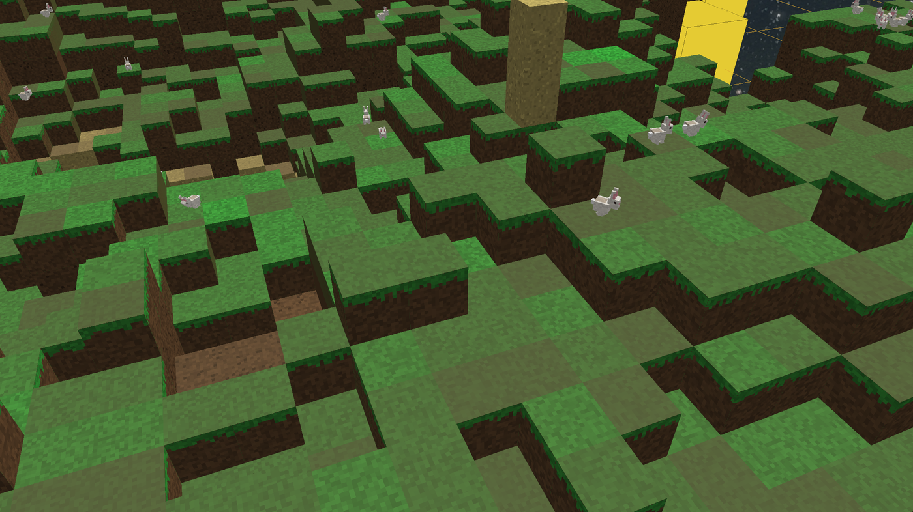

# 6 Terrain Editing: Dig, Place and Spawn Tools per Hand

[Deck](index.md) | [1 Architecture](architecture.md) | [2 Terrain](terrain.md) | [3 Chunks](chunks.md) | [4 Rendering](rendering.md) | [5 Picking](picking.md) | **6 Editing** | [7 Mobs](mobs.md) | [8 Behaviour](behaviour.md) | [9 Ecosystem](ecosystem.md) | [10 Mob Rendering](mob-rendering.md) | [11 First Person](first-person.md) | [12 Panels](panels.md) | [13 Save and Load](save-load.md) | [14 Tests](tests.md) | [15 Findings](findings.md)

Mark set: [marks/06-terrain-editing.json](marks/06-terrain-editing.json)

Each hand can hold a tool. Pulling the trigger with a tool digs a block,
places a block or puts down an animal where the hand's ray hits the terrain.

## 6.1 Tools are SqueakXR hand tools

`SRTool` (SqueakXR) is what a hand does when the trigger is pulled. It is not a
scene object; `SRHand` holds it. On a trigger, `SRHand>>rayCast` casts the
ray, offers the hit to the tool (`handleRaycast:`), and only if the tool
declines passes it to the object hit (`onRaycast:`).

`SWAGameTool` is the game's subclass:

- `handleRaycast:` **declines** anything that is not the game itself, so
  panels, chunk markers and menus still answer the trigger while a tool is
  held.
- For the game it reads `lastVoxelHit` ([Picking](picking.md)) and calls
  `applyAtX:y:z:face:`.

| tool | parameter | does | label |
|---|---|---|---|
| `SWAGameDigTool` | none | `digAtX:y:z:` on the hit voxel | Pick Axe |
| `SWAGamePlaceTool` | `material` | `placeAtX:y:z:face:material:` | the material name |
| `SWAGameSpawnTool` | `species` | `spawn:atX:z:` | Rabbit, Fox |

A tool keeps its parameter as state, so the two hands can hold a place tool
set to sand and one set to rock at the same time. `isSameToolAs:` compares the
parameter too, and `SWAGameXR>>tools` makes a fresh set every time, so two
hands never share an instance.

The hand shows a 4 cm cube in `previewColor` (`SRTool>>newPreviewObject`): the
material's colour from `terrainMaterials`, the pick axe red, or the species'
own colour.

## 6.2 Arming a hand

The tool rows are at the top level of the game's menu (`addToolItemsTo:`):
*Bare hand*, *Pick Axe*, the six materials, then one row per species
(`spawnableSpecies`, sorted so rows do not move). A row arms **the hand that
clicked it** and keeps the menu open, so both hands can be armed from one
menu. `handMarkerFor:` appends `[L]` and `[R]` to the row a hand holds.

## 6.3 What an edit does

**Dig** (`digAtX:y:z:`): `removeBoxAt:` writes air into the voxel store and
marks the chunk dirty, then `syncHeightMapForColumnX:z:` updates the column
height.

**Place** (`placeAtX:y:z:face:material:`): the block goes into the cell **on
the side that was clicked** (`neighbourOf:onFace:`, a nil face meaning the
top), not into the cell that was hit. Refused outside the grid or if the cell
is not air. Then `placeBoxAt:type:` and the height sync.

**Spawn** (`spawn:atX:z:`): the face does not matter; the animal goes on top
of the column, so pointing at a cliff wall still puts it where it can stand.
It enters through `addMobNow:` with this game's parameters
([Mobs](mobs.md)).

After an edit:

- **Collision** sees it at once: mobs and the walking body read the voxel
  store, so a mob over a dug block falls.
- **The mesh** follows at the next frames: the chunk (and a neighbour, for an
  edit on a border) is dirty and rebuilt within the per-frame budget
  ([Chunks](chunks.md)).
- **The simulation's height map** is synced by the edit, because spawning,
  grazing and routing read heights rather than voxels.

The height sync only covers the original 48 x 48 cells (it checks against
`gridWidth` and `gridDepth`). Edits in chunks generated later change the
voxels but not the heights. See [Findings](findings.md).

## 6.4 The older way: slab buttons and terrain clicks

Before hand tools, editing went through the **Terrain Tools** slab
(`createToolSlab`, [Panels and Menus](panels.md)): a button selects a
material or the pick axe (`selectTool:`, kept in `selectedTool`), and a later
bare-hand click on the terrain (`onTerrainClickX:y:z:face:`) applies it via
`applyToolAtX:y:z:face:`.

With no slab tool selected, a bare-hand click either selects the mob within
0.7 cells of the clicked column for the inspector, or spawns the species
selected on the button slab (`onTerrainClickX:z:`).

Both systems work and do the same edits. Selecting a slab tool clears the
species selection and the other way round. Whether to keep both is open
([Findings](findings.md)).

## 6.5 Tests

`testASpawnToolPutsItsOwnSpeciesOnTheColumn`,
`testToolRowsMarkTheHandHoldingThem`, `testEachHandTargetsItsOwnVoxel` (all in
`SWAGameXRMappingTest`). Dig, place and the height sync have no test of their
own; other tests only use them to build terrain.
