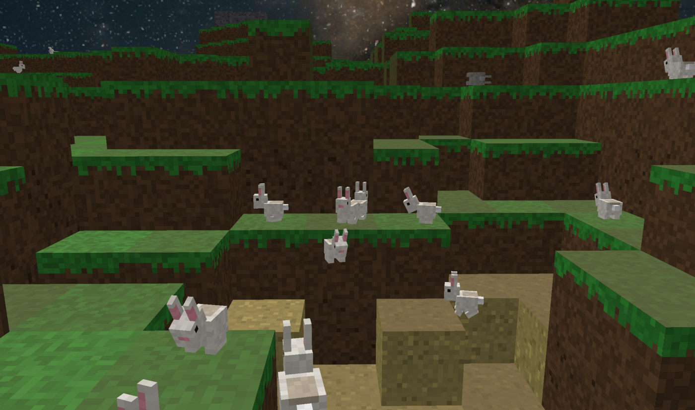

# 11 First Person: Walk Mode, Scale, the Avatar Body

[Deck](index.md) | [1 Architecture](architecture.md) | [2 Terrain](terrain.md) | [3 Chunks](chunks.md) | [4 Rendering](rendering.md) | [5 Picking](picking.md) | [6 Editing](editing.md) | [7 Mobs](mobs.md) | [8 Behaviour](behaviour.md) | [9 Ecosystem](ecosystem.md) | [10 Mob Rendering](mob-rendering.md) | **11 First Person** | [12 Panels](panels.md) | [13 Save and Load](save-load.md) | [14 Tests](tests.md) | [15 Findings](findings.md)

Mark set: [marks/11-first-person.json](marks/11-first-person.json)

The game has two ways to be seen: **on a table**, 5 cm per block, looked at
from above, and **first person**, one metre per block, standing in it.
Settings submenu, *First person: ON/off* (`toggleWalkMode`).

## 11.1 One switch for scale and locomotion

`enterWalkMode` sets the world scale to 1 m and turns on the avatar's
locomotion; `exitWalkMode` goes back to `tableWorldScale` (5 cm) and turns it
off. They are one switch because the other two combinations make no sense:
metre blocks seen from a flying camera, or walking around a 5 cm world.

| | table | first person |
|---|---|---|
| `worldScale` | 5 cm | 1 m |
| avatar locomotion | off | on |
| avatar | rig at its origin (`exitWalkMode`) | on the column under the head |
| panels | beside the board | in front of the player |

## 11.2 Changing the scale

`SWAGameXR>>worldScale:` tells everything that holds the scale:

- the shared `SWAGameSpace` (the mapping between cells and metres; the mesher
  and the mobs use the same instance, see [Architecture](architecture.md)),
- the mesher, which then remeshes **every** chunk (`markAllDirty`); at two
  chunks per frame this takes a few frames,
- the chunk markers, rebuilt; their size is capped at 120 cm, what a standing
  player can reach (`chunkMarkerSize`),
- at the table, the panels (`repositionPanelsAtTable`).

## 11.3 Standing on the terrain

`placeAvatarOnSurface` takes the cell under the **head** (the camera), since
the player may have walked metres away from the rig origin. Over a chunk not
generated yet it picks the middle of a generated one. Then
`SRAvatar>>teleportTo:` the top of that column; the avatar stands its body
under the head.

## 11.4 Walking

The walking itself is SqueakXR's: the avatar's locomotion (teleport or
continuous, the global preference in the *Locomotion* row of the settings
submenu) sweeps the avatar's body box through the scene. The game only has to
be solid, which `SWAGameVoxelCollider>>intersectsBoxCenter:halfExtents:`
answers from the voxel store ([Picking](picking.md)). Ungenerated chunks count
as solid, so the edge of the world is a wall, not a drop.

The body the player sees of themselves in first person is SqueakXR's avatar
body, not part of the game.

## 11.5 Panels come to the player

At 1 m per block, the board edge where the panels stand at the table is 16 m
away and the panels would be 12 m up. So:

- **Panel sizes do not scale.** `panelScale` is the old table scale (5 cm), a
  size for a hand, not a property of the terrain; at 1 m per block it once
  gave 2 m buttons.
- **New panels** in walk mode appear 60 cm ahead, 45 cm to the side and 20 cm
  below the eyes (`placeNewPanel:atSide:z:`), and panels opened from the menu
  appear beside the menu (`placePanel:besideMenu:`).
- **On entering walk mode** the open slabs are brought to the right hand
  (`bringPanelsToHand:`), placed where SqueakXR places a context menu.
- **Facing** (`facingFrom:toward:`): a yaw towards the viewer and a quarter turn
  that stands the tray up. Yaw only, so a panel never takes over the pitch or
  roll of the head (`testPanelFacingIgnoresHeadPitchAndRoll`).

## 11.6 The simulation follows the player

With a simulation radius set (preference, chunks), `updateSimulationCentre`
moves the simulated area to the chunk under the camera every tick
([Chunks](chunks.md)). This matters in first person, where the world can be
grown far beyond what is looked at.

## 11.7 Known gaps

- Walk mode belongs to the `SWAGameXR`, not to the saved world: loading a game
  (`adoptWorld:`) keeps whichever mode is on.
- `exitWalkMode` puts the avatar back at the rig origin, wherever the player
  was standing.
