<!-- markdown-config presentation=true -->

<!---
Feature overview of SWAGameXR, one or more slides per topic. Each covered topic
has a reference page beside this deck (architecture.md, terrain.md, chunks.md)
and a mark set in marks/ for the Code Map / class diagram / browser.
Every topic starts with a section slide (div.section, data-number); the
contents slide is generated from them. Planned topics have only that slide.
Screenshots still missing are marked with SHOT comments.
--->

<link rel="stylesheet" type="text/css" href="../../../lively4-core/src/client/presentation.css"  />
<link rel="stylesheet" type="text/css" href="../../../lively4-core/src/client/lively.css"  />
<link rel="stylesheet" type="text/css" href="../../../lively4-core/templates/livelystyle.css"  />

<style>
.marks { position: absolute; bottom: 10px; left: 20px; font-size: 14px; color: gray; }

ul.contents { columns: 2; column-gap: 40px; padding-left: 0; margin-top: 20px; }
ul.contents li { font-size: 16pt; line-height: 120%; margin: 0 0 14px 0; padding: 0 0 0 2em; text-indent: -2em; break-inside: avoid; }
ul.contents li::before { content: none; }
ul.contents li b { display: inline-block; width: 2em; text-indent: 0; }
ul.contents li.planned { color: #999; }
ul.contents li { cursor: pointer; }

/* Section slides: a picture on top, the heading at the bottom. */
.section { position: absolute; left: 70px; right: 40px; bottom: 70px; margin: 0; }
.section::before { content: attr(data-number) " "; }
.section.planned { color: #999; }
img.section-picture { position: absolute; top: 30px; left: 20px; width: calc(100% - 40px); height: 400px; max-width: none; object-fit: contain; }
.lively-slide > p.planned-note { position: absolute; left: 70px; bottom: 15px; margin: 0; color: #999; }

/* Text in the left two thirds, pictures in the right third (.side).
   Wide diagrams (.wide, drawio) keep the full width. */
.lively-slide > p, .lively-slide > ul:not(.contents), .lively-slide > ol,
.lively-slide > table, .lively-slide > pre { max-width: 64%; box-sizing: border-box; }
.lively-slide > p:has(.wide), .lively-slide > p:has(lively-drawio) { max-width: none; }
.lively-slide > ul:not(.contents) > li, .lively-slide > ol > li { font-size: 16pt; margin: 12px 0 0 0; }
.lively-slide > ul:not(.contents) > li:first-child, .lively-slide > ol > li:first-child { margin-top: 0; }
.lively-slide li li { font-size: 14pt; }
img.wide { width: 100%; }
.lively-slide > p.caption { max-width: none; font-size: 14pt; }
img.side { position: absolute; top: 110px; right: 20px; width: 360px; max-width: none; }

.title-page { text-align: center; }
.title-page img { display: block; margin: 20px auto 0 auto; height: 230px; }
.title-page .title { margin-top: 30px; }
.title-page .subtitle { margin-top: 15px; }
.title-page .authors { margin-top: 40px; }
.title-page .credentials { margin-top: 15px; line-height: 150%; }

/* Layout guide: the slide box, which is the whole 16:9 screen in fullscreen.
   Remove for the talk. */
.lively-slide { outline: 1px solid #ccc; }
</style>

<script>
import Presentation from "src/components/widgets/lively-presentation.js"
Presentation.config(this, {aspectRatio: 16/9})
</script>


<div class="title-page">
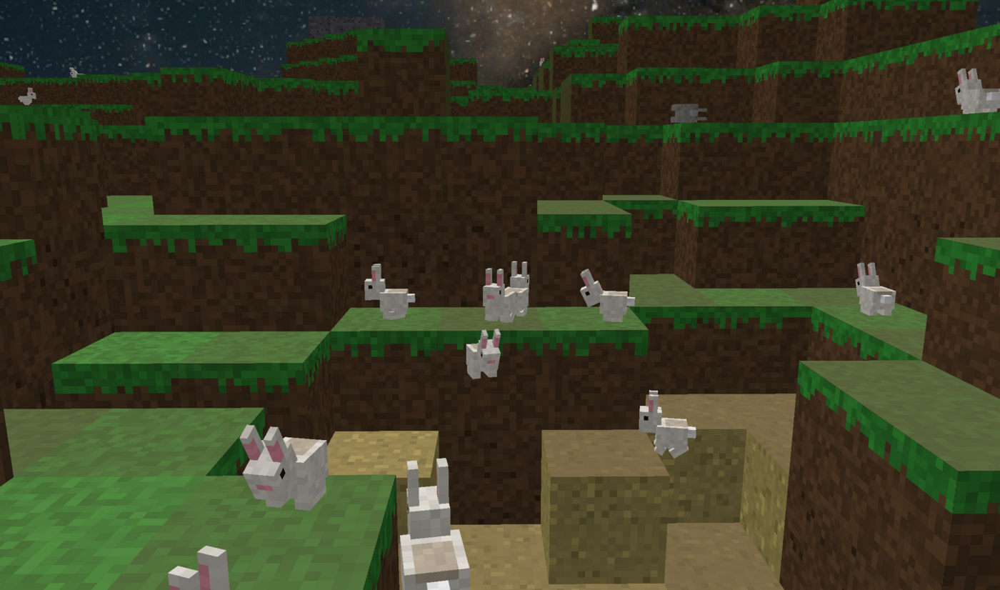
<div class="title">SWAGameXR: a Voxel World in SqueakXR</div>
<div class="subtitle">A sandbox game as a sample application of SqueakXR</div>
<div class="authors">Jens Lincke</div>
<div class="credentials">Package <code>SWAGame</code>, repository <code>mysqueak</code><br>Nov 2026</div>
</div>


---
## Contents

<ul class="contents"></ul>

<script>
(async () => {
  var presentation
  for (var i = 0; i < 50 && !(presentation && presentation.slides); i++) {
    await lively.sleep(100)
    presentation = lively.query(this, "lively-presentation")
  }
  if (!presentation) return
  var list = presentation.querySelector("ul.contents")
  list.innerHTML = ""
  presentation.slides().forEach(slide => {
    var section = slide.querySelector(".section")
    if (!section) return
    var li = document.createElement("li")
    if (section.classList.contains("planned")) li.classList.add("planned")
    var number = document.createElement("b")
    number.textContent = section.dataset.number
    li.appendChild(number)
    li.appendChild(document.createTextNode(section.dataset.title || section.textContent))
    li.addEventListener("click", () => presentation.setSlide(slide))
    list.appendChild(li)
  })
})()
""
</script>


---
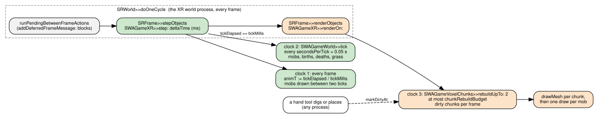
<div class="section" data-number="1">Architecture and Frame Loop</div>

---
## 1.1 What It Is

- A **sandbox game**: blocks, rabbits and foxes, an ecosystem simulation; on a table or at one metre per block
- **One sample application** of SqueakXR
- Developed in XR with the other tools in the same world: workspace, code browser, AI agent chat
- At the very least, a **place to stand** while working in XR
- Direction (part of Leo's motivation): standing in the world, the developer asks an AI agent, by voice or chat, to change the simulation or the world live, or does it in a workspace
- 52 classes, 940 methods, 122 tests; the code is in the image, `src/` is an export

{.side}

<div class="marks">Details: <a href="architecture.md">1.1 What it is</a></div>

---
## 1.2 SqueakXR Interfaces Used

| SqueakXR | in the game |
|---|---|
| `step:`, `renderOn:` | one scene node ticks the simulation and draws with raw Raylib |
| `<xrMenu:>`, `isApp` | World > games > SWAGame; then B opens the game's own menu |
| `SRTool` per hand | dig, place a block, spawn an animal |
| `SRCollisionGeometry` | rays pick voxels; the avatar walks on the terrain |
| `<shaderSource:>` | block patterns and animated animals in GLSL |
| `SRMesh`, `SRTexture`, `unload` | a mesh per chunk and per animal design, released explicitly |
| `<preference:>` | block looks, animal models, species parameters, in the XR menu |

<div class="marks">Details: <a href="architecture.md">1.2 SqueakXR interfaces used</a> -- marks/01-architecture-and-frame-loop.json</div>

---
## 1.3 Classes

{style="width: 100%"}

Bands: layers. Left of the middle: cells, right: metres. Red edge: the same object. {.caption}

<div class="marks">Details: <a href="architecture.md">1.3 Classes</a> -- marks/01-architecture-and-frame-loop.json</div>

---
## 1.6 Frame Loop and Update Rates

{.wide}

- **Every frame** `SWAGameXR>>step:` moves `animT`; mobs are drawn between two ticks
- **Every 0.05 s** `SWAGameWorld>>tick`; rates are per second, a long frame runs one tick, not a burst
- **Two chunks per frame** the mesher catches up with edits
- The frame rate affects smoothness, the tick rate affects cost; the mesh may lag behind an edit, collision reads the voxel store and does not

<div class="marks">Details: <a href="architecture.md">1.6 Frame loop and update rates</a> -- marks/01-architecture-and-frame-loop.json</div>

---
## 1.7 Rendering and Per-Frame Allocation

- Terrain first: `drawMesh` replaces the matrix that the mob pass pushes
- One transform and one material for all chunk meshes
- Raylib structs owned and refilled: ~1 KB to allocate, ~5 B to refill
- Mob render entries reused across ticks: no young objects referenced by an old game
- GPU work from menus or MCP goes through `addDeferredFrameMessage:`: loading a game, removing it, unloading retired meshes

<div class="marks">Details: <a href="architecture.md">1.7 Rendering and per-frame allocation, 1.8 Processes and the GPU</a> -- marks/01-architecture-and-frame-loop.json</div>

---
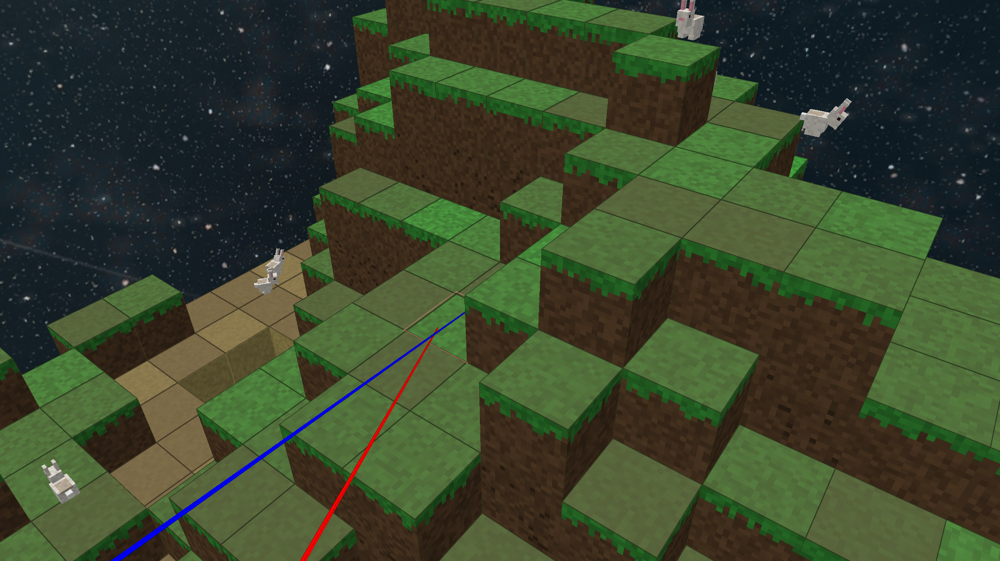
<div class="section" data-number="2">Terrain Generation</div>

---
## 2.2 Terrain: Height from Noise

- `SWAPerlinNoise`, 4 octaves at 0.08 per cell, mapped to 1..20 blocks
- The height depends only on where the column is: chunks join without seams, in any order, as long as the world has **one** noise instance
- Heights and grass per chunk, 256 bytes each: no fixed world extent
- A saved game stores the permutation, so a loaded world keeps growing the same land

{.side}

<div class="marks">Details: <a href="terrain.md">2.2 Height from noise, 2.3 Height and grass storage</a> -- marks/02-terrain-generation.json</div>

---
## 2.4 Terrain: Block Types by Elevation

| below surface | <= 0.2 | <= 0.35 | <= 0.7 | <= 0.85 | above |
|---|---|---|---|---|---|
| dirt | water | sand | grass | rock | snow |

- A voxel is one byte, a block id (`SWAGameBlocks`), 0 is air
- The id rides in the vertex colour alpha: the shader patterns blocks without a texture
- Grassland is the 0.2 to 0.7 band; grass levels 0 to 10
- Rivers are a **dead feature**: `riverMap` is never filled since per-chunk generation

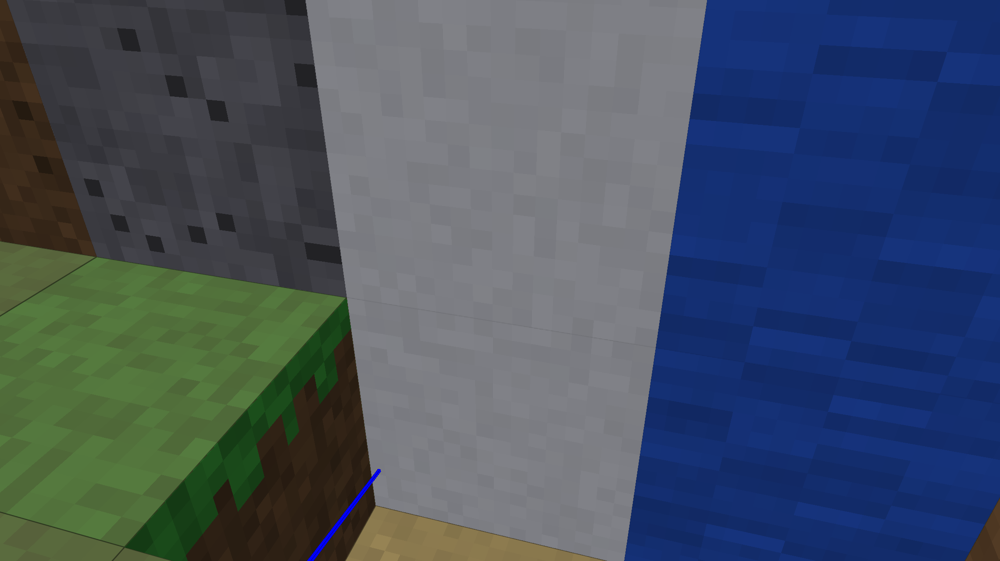{.side}

<div class="marks">Details: <a href="terrain.md">2.4 Block types by elevation, 2.7 Rivers</a> -- marks/02-terrain-generation.json</div>

---
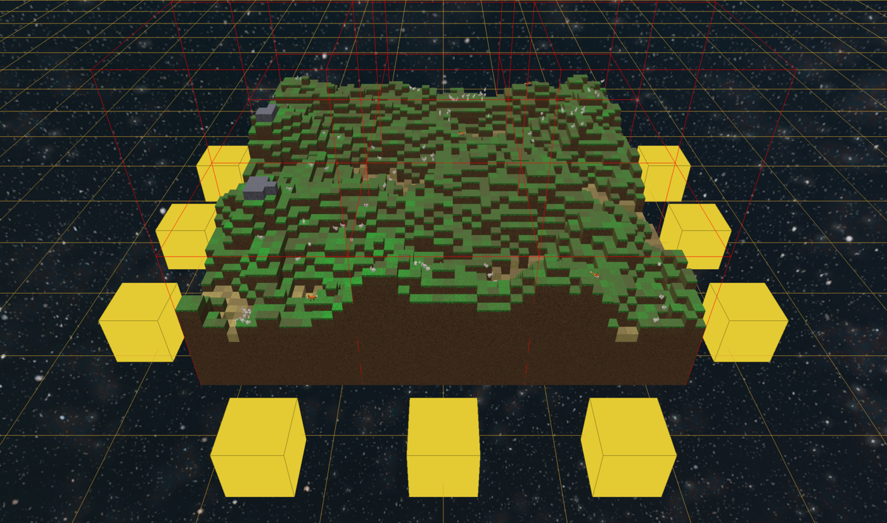
<div class="section" data-number="3">Chunks: Storage, Meshing, Growth, Simulation</div>

---
## 3 Chunks: Overview

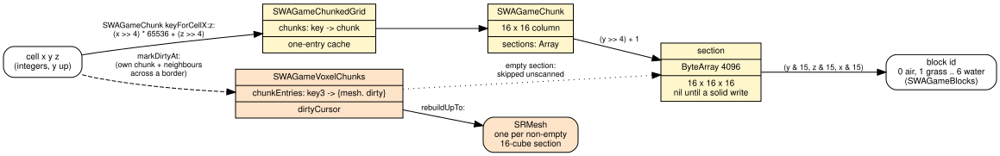{.wide}

- **Storage**: 16 x 16 columns of 16-cube sections, allocated on the first solid write
- **Meshing**: one mesh per 16-cube, so empty sections are skipped unscanned
- **Growth**: a Generate marker on every empty neighbour chunk
- **Simulation**: mobs live in chunk buckets; a radius freezes distant chunks

<div class="marks">Details: <a href="chunks.md">3 Chunks, 3.2 Storage, 3.3 Meshing</a> -- marks/03-chunks.json</div>

---
## 3.3 Chunks: Incremental Meshing

- Before: a one-block edit remeshed the whole world; now the mesh is partitioned into chunks
- Face culling depends only on the six neighbours of a block, so chunks can be meshed separately; an edit on a chunk border also marks the neighbouring chunk dirty
- Small units of work fit into the time left in a frame: the same full remesh took 54 ms on an idle image and 292 ms with the render loop running
- Edits come from other processes: marking is a single store, and the flag is cleared before meshing, so a concurrent edit causes a redundant rebuild, never a lost one
- Collision and picking read the voxel store, not the mesh

<div class="marks">Details: <a href="chunks.md">3.1 Motivation, 3.3.1 Dirty tracking</a> -- marks/03-chunks.json -- essay: squeak/journal/2026-07-30b-chunking-conceptually.md</div>

---
## 3.4 Chunks: World Growth and Simulation Radius

- New game: 3 x 3 chunks; then click a yellow **Generate** marker on the floor
- A new chunk: heights, grass, blocks, five rabbits and a fox, new markers
- An ungenerated chunk counts as solid, for mobs and for the walking avatar
- `simulationRadiusChunks` (preference, 0 = all): chunks outside the radius are not stepped, and their mobs are left out of the neighbour indexes

{.side}

<div class="marks">Details: <a href="chunks.md">3.4 Growing the world, 3.6 Simulation radius</a> -- marks/03-chunks.json</div>

---
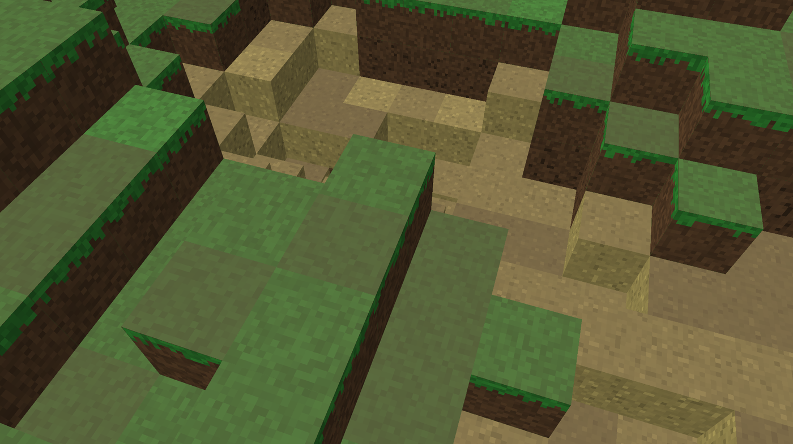
<div class="section" data-number="4">Terrain Rendering: Block Patterns, Grass Map, Outlines</div>

---
## 4 Terrain Rendering: One Shader, No Block Textures

- One shader, `swagameTerrain`, over all chunk meshes
- The block **id** rides in the vertex colour alpha: 16 x 16 pixel patterns are computed per pixel from a hash, no texture atlas
- Grass overhangs the side by 2 to 4 pixels; patterns fade to their average once a block pixel is smaller than a screen pixel
- Grazing is a **grass map texture**, one pixel per column, level in green and grassland in alpha (the two channels BGRA leaves alone), not baked into the mesh
- Outlines from face texcoords and `fwidth`: a width in pixels, right per eye; off by default

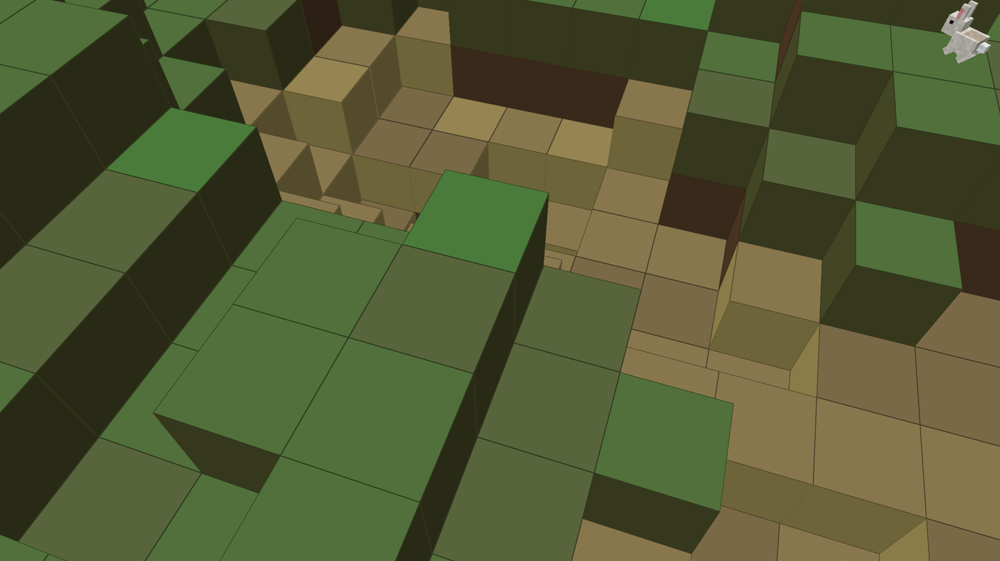{.side}

<div class="marks">Details: <a href="rendering.md">4.2 Block id, 4.3 Patterns, 4.4 Grass map, 4.5 Outlines</a> -- marks/04-terrain-rendering.json</div>

---
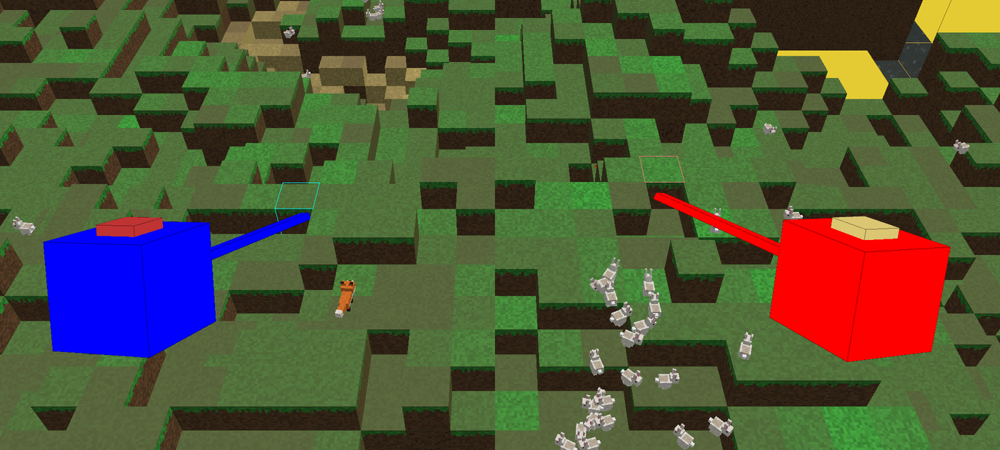
<div class="section" data-number="5">Picking: Voxel Collider, Ray Walk, Hand Targets</div>

---
## 5 Picking: One Collider for Every Voxel

- `SWAGameVoxelCollider` answers rays and box sweeps from the voxel store; it replaced one collision box per column, which only knew the top block
- Rays: a 3D DDA (`SWAGameVoxelRayWalk`) in cell space, clipped to the generated chunks; cost grows with the ray, not the world
- Kept in small methods: as one 1552-byte method it crashed the Quest's ARM64 JIT
- The hit face goes back through `noteVoxelHit...`: `SRHand` rebuilds the result and keeps only object and point
- Every frame each hand shows a wire box round the voxel it points at, armed or not

{.side}

<div class="marks">Details: <a href="picking.md">5.2 Ray walk, 5.3 Face, 5.4 Body sweep, 5.5 Hand targets</a> -- marks/05-picking.json</div>

---
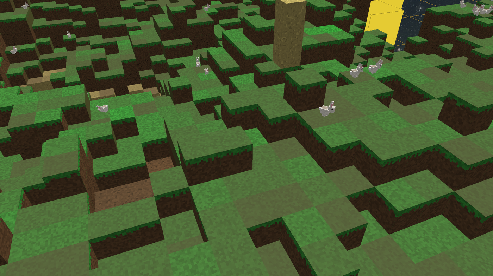
<div class="section" data-number="6">Terrain Editing: Dig, Place and Spawn Tools per Hand</div>

---
## 6 Terrain Editing: Tools per Hand

- `SWAGameTool` is a SqueakXR `SRTool`: offered every trigger hit first, it declines all but the terrain
- Pick axe, one place tool per material, one spawn tool per species; the parameter is tool state, so each hand can hold a different block
- Armed from the top of the game's menu; the row arms the hand that clicked it, `[L]` `[R]` show who holds what
- Place goes into the cell on the clicked face; spawn goes on top of the column
- Collision sees an edit at once, the mesh within a few frames, the height map is synced (only in the original 48 x 48)
- The older tool slab plus terrain click still works: two systems for the same edits

{.side}

<div class="marks">Details: <a href="editing.md">6.1 Tools, 6.3 What an edit does, 6.4 The older way</a> -- marks/06-terrain-editing.json</div>

---
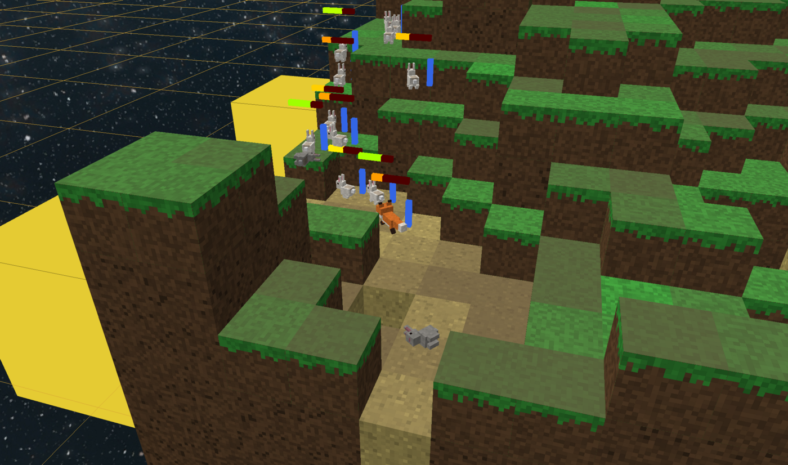
<div class="section" data-number="7">Mobs: State, Energy, Bodies, Physics</div>

---
## 7 Mobs: State and Physics

- Rabbits and foxes at continuous positions, in cells; no rendering in the simulation
- Gravity and collision, resolved one axis at a time; a blocked horizontal move triggers a jump of one block
- Substeps above a quarter cell, a fast path for mobs standing still
- Separation by a soft mutual push, as in Minecraft, instead of hard collision between mobs
- Energy is consumed per second; a dead mob leaves a body that can be eaten for 30 s

{.side}

<div class="marks">Details: <a href="mobs.md">7 Mobs: 7.3 Physics, 7.4 Separation, 7.6 Bodies</a> -- marks/07-mobs.json</div>

---
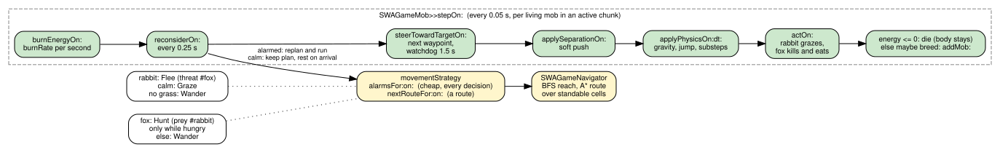
<div class="section" data-number="8">Behaviour: Deciding, Routing, Eating, Resting</div>

---
## 8 Behaviour: Decisions and Path Finding

{.wide}

- Every 0.25 s the strategy is asked whether there is a threat or prey; if so the mob replans and runs, otherwise it keeps its route, walks, and rests on arrival
- Path finding over standable cells: up one block, down at most three, diagonals only on flat ground
- A waypoint is abandoned after 1.5 s without progress
- Eating has a duration: 3 s for a rabbit on a grass tile, 8 s for a fox on a body

<div class="marks">Details: <a href="behaviour.md">8 Behaviour: 8.1 Decision loop, 8.2 Strategies, 8.3 Routing</a> -- marks/08-behaviour.json</div>

---
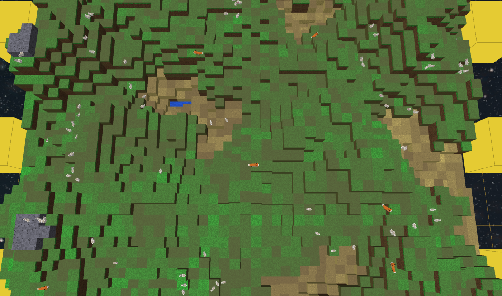
<div class="section" data-number="9">Ecosystem: Grass, Breeding, Scenarios, Headless Runs</div>

---
## 9 Ecosystem: Parameters and Headless Simulation

- The grass regrowth rate limits the rabbit population; hunger and territory limit the foxes
- All parameters are preferences; each game can override them
- **Scenarios**: Balanced, Nature documentary, Rabbit plague, Fox paradise, Boom and bust
- `SWAGameSimulation` runs a copy headless, 30 simulated minutes in about 20 s, and gives a verdict: steady, cycling, foxesDied, collapse
- Balanced lost a species in 3 of 4 runs on 32-cell worlds; after three changes 4 of 4 runs were steady

{.side}

<div class="marks">Details: <a href="ecosystem.md">9 Ecosystem: 9.1 Grass, 9.6 Scenarios, 9.7 Headless simulation</a> -- marks/09-ecosystem.json</div>

---
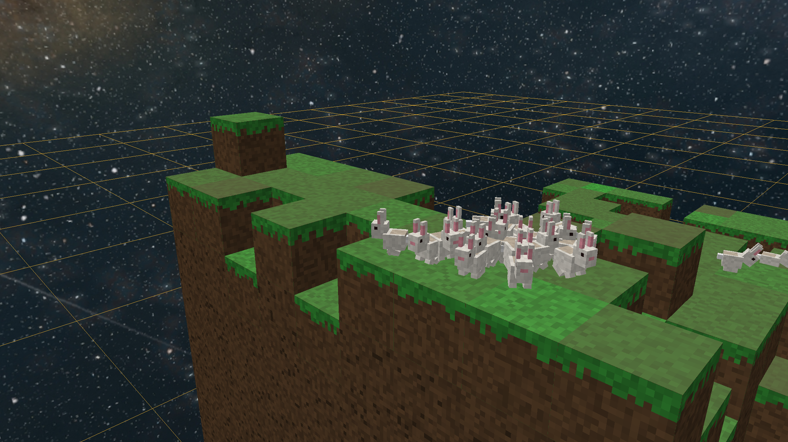
<div class="section" data-number="10">Mob Rendering: Voxel Models, Gaits, One Draw per Animal</div>

---
## 10 Mob Rendering: Models, Gaits, One Draw Each

- **Model** per species: boxes of 1/16-block voxels, grouped by limb and pivot; rabbits hop, foxes trot
- One mesh per species; limb code in vertex alpha, pivot in texcoords; the `swagameMob` vertex shader swings legs, head and tail
- **Gait** per mob: heading, stride phase, swing at the last two ticks, interpolated per frame; phase follows distance walked, not time
- Eating lowers the head, bodies lie on their side and shrink
- One `drawMesh` per animal, transform composed into reused arrays; preference off, or no shader: coloured cubes

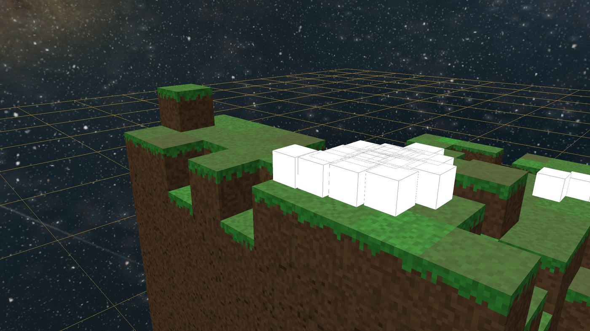{.side}

<div class="marks">Details: <a href="mob-rendering.md">10.0 Overview, 10.1 Models, 10.3 Shader, 10.4 Gaits, 10.5 Poses, 10.6 Drawing</a> -- marks/10-mob-rendering.json</div>

---

<div class="section" data-number="11">First Person: Walk Mode, Scale, the Avatar Body</div>

---
## 11 First Person: One Switch

- Table: 5 cm per block, seen from above; first person: 1 m per block, standing in it
- Scale and locomotion are one switch: metre blocks from a flying camera, or walking round a 5 cm world, make no sense
- The scale goes to the shared `SWAGameSpace` and the mesher (full remesh), markers capped at reach
- The player lands on the column under the head; walking is SqueakXR's, the terrain only has to be solid
- Panels keep their hand size and come to the player, facing them, yaw only

{.side}

<div class="marks">Details: <a href="first-person.md">11.1 One switch, 11.4 Walking, 11.5 Panels</a> -- marks/11-first-person.json</div>

---
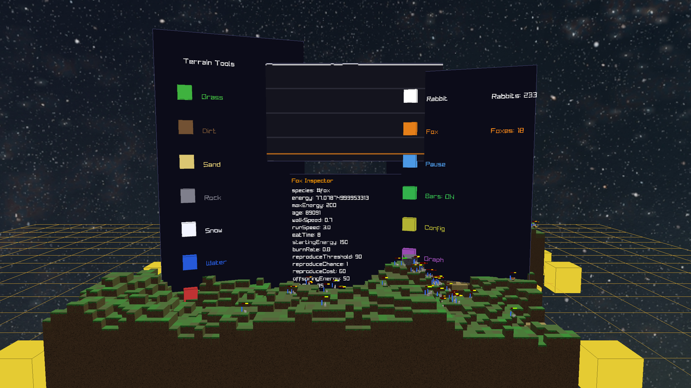
<div class="section" data-number="12">Panels and Menus: App Menu, Settings, Graph, Inspector</div>

---
## 12 Panels and Menus

- World > games > SWAGame puts a game on the floor ahead, square to the room
- The game's menu: settings, scenarios, game (save, load), then the tool rows; toggle rows stay open and name their state
- Slabs: button slab, terrain tools, population graph, mob inspector; world children, grabbed as a whole
- Beside the board at the table, beside the menu when opened from it, in front of the player in walk mode
- A Morphic window with sliders tunes the image defaults without a headset

{.side}

<div class="marks">Details: <a href="panels.md">12.2 Menu, 12.3 Slabs, 12.4 Placement, 12.7 Config window</a> -- marks/12-panels-and-menus.json</div>

---
<div class="section" data-number="13">Save and Load</div>

---
## 13 Save and Load

- One JSON file per game in `swagame-worlds/`: chunks, voxel sections, mobs, the game's parameters, the noise
- Byte arrays deflated and Base64: a 4 KB section of one block type is a few dozen characters
- Captured unpreempted, so a save is never of a half-ticked world
- Loading swaps the world in between frames; mobs come back through `addMobNow:` with the game's parameters
- Not saved: what mobs are doing, gaits, the random stream, anything of the scene object
- `detachedCopy` is a save and a load: the copies headless simulations run on

<div class="marks">Details: <a href="save-load.md">13.2 Format, 13.4 Loading, 13.5 Not saved</a> -- marks/13-save-and-load.json</div>

---
<div class="section" data-number="14">Tests</div>

---
## 14 Tests

- 121 test methods in 13 classes; names are sentences (`testAThreatInterruptsAMeal`)
- Most build a headless `SWAGameWorld`; none touch the running world
- `SWAGameTestCase` nils the preferences in `setUp` and restores them in `tearDown`: tests see the code defaults, and running them never retunes the game
- Retuning the rabbits once failed a flee test without a code change; that is why
- Not covered: dig and place, the height sync, walk mode, the shader

<div class="marks">Details: <a href="tests.md">14.1 What they guard, 14.2 Preference isolation</a> -- marks/14-tests.json</div>

---
<div class="section" data-number="15">Findings: Dead Code, Dead Features, Polish</div>

---
## 15 Findings: Known Problems

- Dead classes: `SWACube`, `SWAGameCube`, `SWAGameLibrary` (the FFI era)
- Unused features: rivers, the board-game scale; two parallel terrain tool systems
- Six features still stop at the original 48 x 48 area (grass tint, height sync after digging, chunk bounds, ...)
- `SWAGameXR`: 64 instance variables, 149 methods; `createButtonSlab` (1380 bytes) is near the ARM JIT hazard

<div class="marks">Details: <a href="findings.md">15 Findings</a></div>

---
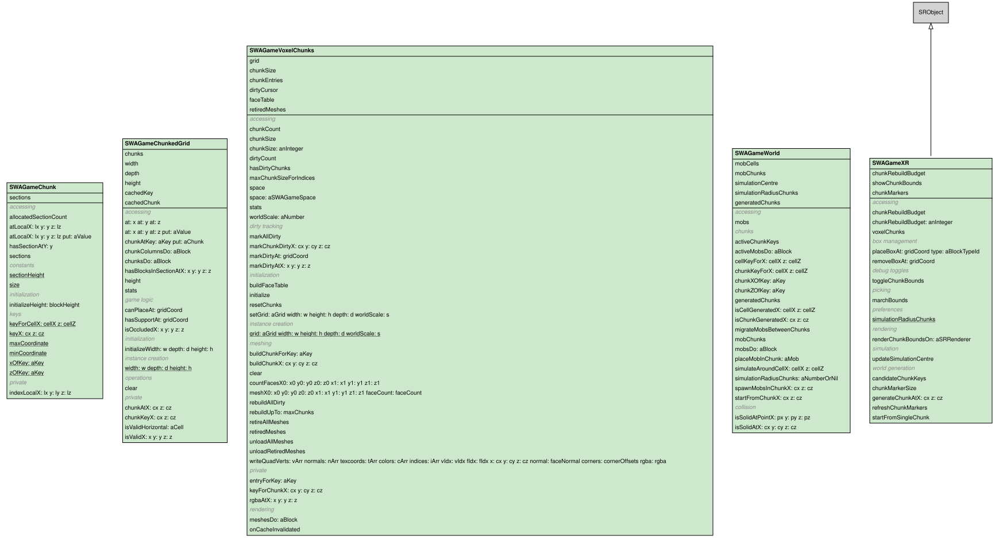
<div class="section" data-number="A">Appendix: Reading a Topic in the Tools, Conventions</div>

---
## A.1 Inspecting a Topic in the Tools

1. Code Map, package `SWAGame`
2. Marks flap, burger menu, *Load*: `doc/swagame/marks/03-chunks.json`
3. Switch to *Class diagram* or *Browser*: same marks, with the notes on the key places
4. The generated snippet of the same set: `figures/03-chunks.svg`

```smalltalk
SWAClassDiagram openOnMarks.   "the marked members only"
```

---
## A.2 Comment and Documentation Conventions

- The image is the source of truth; these pages explain, they do not repeat code
- A method comment states what the code cannot show: a crash mode, an ordering, a unit, an identity that must hold. One line where possible
- History, design reasoning and measurements live here and in the journal
- Each page's mark set is also the scope of its comment pass

<div class="marks">Details: <a href="findings.md">15.9 Comments moved to these pages</a></div>
