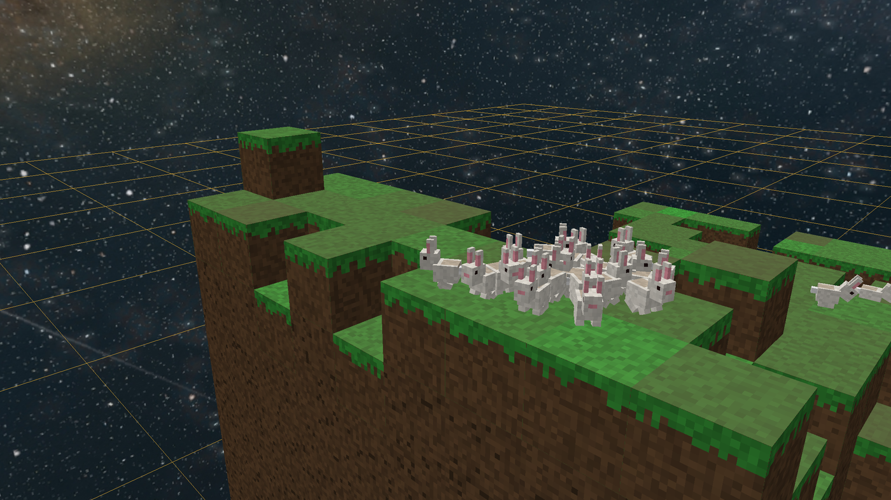
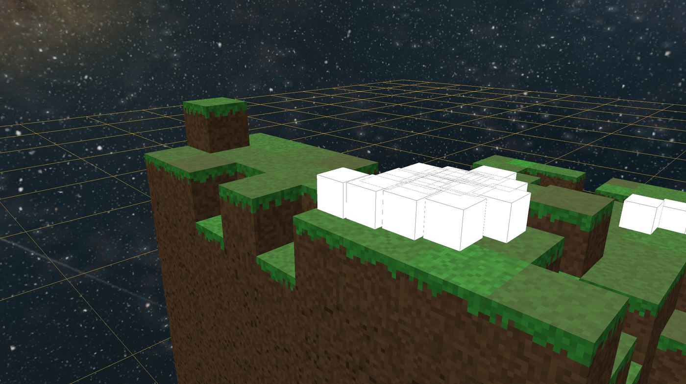
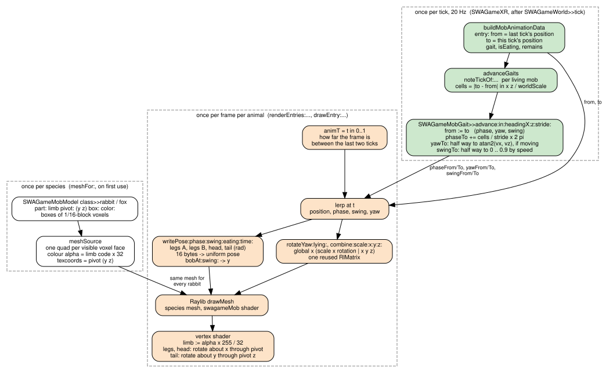
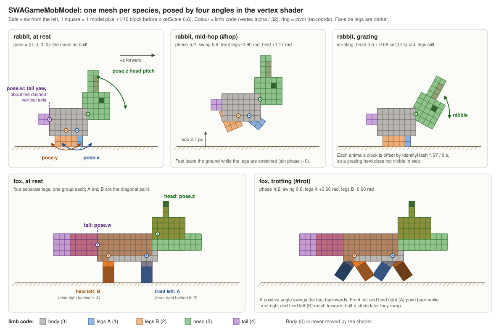
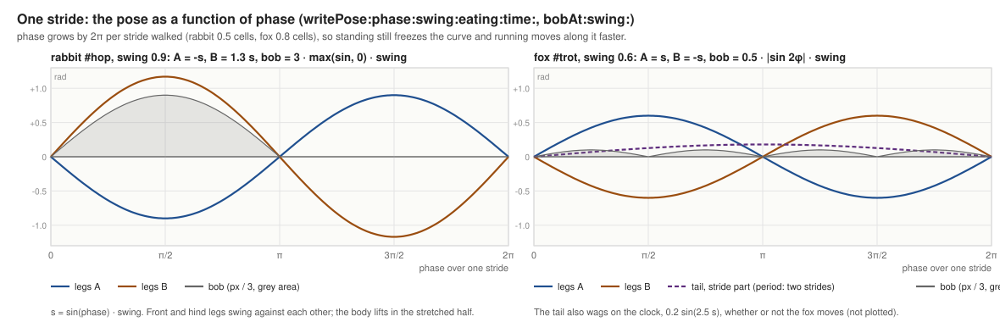

# 10 Mob Rendering: Voxel Models, Gaits, One Draw per Animal

[Deck](index.md) | [1 Architecture](architecture.md) | [2 Terrain](terrain.md) | [3 Chunks](chunks.md) | [4 Rendering](rendering.md) | [5 Picking](picking.md) | [6 Editing](editing.md) | [7 Mobs](mobs.md) | [8 Behaviour](behaviour.md) | [9 Ecosystem](ecosystem.md) | **10 Mob Rendering** | [11 First Person](first-person.md) | [12 Panels](panels.md) | [13 Save and Load](save-load.md) | [14 Tests](tests.md) | [15 Findings](findings.md)

Mark set: [marks/10-mob-rendering.json](marks/10-mob-rendering.json)



The simulation knows mobs as boxes at continuous positions
([Mobs](mobs.md)). How they look is three classes and one shader:

| class | one per | knows |
|---|---|---|
| `SWAGameMobModel` | species | the animal as 1/16-block voxels, grouped by limb |
| `SWAGameMobGait` | mob | heading, stride phase and leg swing at the last two ticks |
| `SWAGameMobRenderer` | game | meshes, gaits, the `swagameMob` shader; draws |

Preference **Animal models** (on by default). Off, or when the shader is not
available, `SWAGameXR>>renderOn:` draws every mob as a coloured cube with a
dark wire frame and every body as a flat box, as before the models existed:



## 10.0 The animation in one paragraph

There is no skeleton, no keyframes and no per-animal mesh. Each species is
**one static mesh** in which every vertex carries two extra facts: which limb it
belongs to and where that limb's joint (pivot) is. Per animal and frame the CPU
computes **four angles**: legs A, legs B, head pitch and tail yaw. It hands them
to the shader as one `vec4 pose`, and the vertex shader rotates each vertex
about its own pivot by the angle of its limb. What makes the animals look alive
is where the four angles come from. They are sines of a **stride phase** that
grows with the distance walked, scaled by a **swing** that grows with speed.
Phase, swing and heading are updated at 20 Hz with the simulation and
interpolated per frame, so the legs move smoothly at any frame rate.



The three dashed boxes in the figure are three rates:

| when | what | where |
|---|---|---|
| once per species | boxes become a mesh with limb and pivot baked in | `SWAGameMobModel` |
| once per tick (20 Hz) | phase, heading and swing step forward | `SWAGameMobGait` |
| once per frame | interpolate, turn into four angles, one `drawMesh` | `SWAGameMobRenderer`, `swagameMob` |

## 10.1 Models

`SWAGameMobModel class>>rabbit` and `>>fox` build the animals from boxes,
in pixels, a block being 16 pixels, `+z` forward and `x = 0` the middle:

```smalltalk
part: #head pivot: #(6 3) box: #(-2 5 2 2 10 7) color: fur
```

- Each box belongs to a **limb**: `#body #legsA #legsB #head #tail`
  (`limbCodes`), and a limb with its **pivot** (y z, in pixels) is a group.
  Later boxes of a group paint over earlier ones, which is how eyes and ears
  get their colour.
- `pixelScale` 0.6 makes an animal a bit smaller than 16 pixels per block.
- `gait`: the rabbit **hops** (stride 0.5 cells), the fox **trots** (stride
  0.8 cells, diagonal leg pairs).
- `lieLift` lifts a body lying on its side so it does not sink into the
  ground.



*Drawn from the boxes in `rabbit` and `fox` by
[figures/mob-rig.py](figures/mob-rig.py); rerun it when the models change.*

What the figure shows:

- **Only four things move.** The body (code 0) is never touched by the
  shader. Everything else is a rigid group that turns about one pivot.
- **Legs A and legs B are two groups, not four legs.** The rabbit's two front
  legs are both A and its two hind legs both B, so they move as pairs. The
  fox's legs are separate boxes, but front left and hind right share code A
  and the other diagonal shares B. A single angle per code then gives a trot.
  Legs with the same pivot y z but different x are still one group, because
  the rotation is about the x axis and x does not matter.
- **A pivot is a hip, a neck or a tail root**: the top of the leg, the
  bottom of the head. A positive leg angle swings the foot backwards, and a
  positive head angle lowers the nose.
- The fox's legs reach two pixels up into the body (`leg:x:z:orange:dark:`),
  so no gap opens at the hip when they swing.

## 10.2 Mesh

`meshSource` emits one quad per visible voxel face:

- Faces between two voxels of the **same** group are culled. Faces between
  groups are kept, because a swinging leg uncovers the body face behind it.
- Each voxel gets a little brightness noise (`shadeX:y:z:`), the grain a
  Minecraft texture has.
- **The limb travels in the vertex colour alpha** (code times 32) and **the
  pivot in the texcoords**, so the shader can pose the mesh with no extra
  vertex attributes. One mesh per species, 16-bit indices
  (`testSpeciesFitSixteenBitIndices`).

## 10.3 The shader

`SWAGameMobRenderer class>>swagameMob`:

- **Vertex**: legs and head rotate about the x axis through their pivot,
  by `pose.x` (legs A), `pose.y` (legs B), `pose.z` (head pitch, down is
  positive); the tail turns about y by `pose.w`. Normals turn with them.
- **Fragment**: the terrain's light with more ambient (0.55), because white fur
  in shadow should still read as white; times `tint`, 0.6 for bodies.

Step by step, for one vertex:

1. `limb = floor(alpha * 255 / 32 + 0.5)`, the code back from the colour
   (`0 32 64 96 128` -> `0 1 2 3 4`). Rounding absorbs the 8-bit conversion.
2. `pivot = texcoord` = (pivot y, pivot z) in model pixels.
3. Limbs 1 to 3: pick the angle `a` (`pose.x`, `.y` or `.z`) and rotate the
   vertex in the y z plane around the pivot:

   ```glsl
   q   = (p.y - pivot.y, p.z - pivot.z)
   p.y = pivot.y + cos a * q.y - sin a * q.z
   p.z = pivot.z + sin a * q.y + cos a * q.z
   ```

   A foot below the hip has `q.y < 0`, so `p.z` moves backwards for `a > 0`.
4. Limb 4, the tail: the same rotation in the x z plane by `pose.w`, about
   the vertical line `x = 0, z = pivot z`. Pivot y is not used.
5. `mvp` then applies the per-animal transform from 10.6, so yaw, scale and
   position come after the pose.

The mesh is still the model in model pixels at this point. Posing happens
before scaling, so the angles and pivots stay in the units the model was
written in.

## 10.4 Gaits

The simulation ticks 20 times a second, the screen draws far more often. A
gait keeps each value at the last two ticks, and the renderer interpolates
between them with the same `animT` that moves the mob
([Architecture](architecture.md)).

`SWAGameXR>>advanceGaits` calls `noteTickOf:from:to:worldScale:seconds:`
once per tick for every living mob, and `SWAGameMobGait>>advance:in:headingX:z:stride:`:

- **Phase follows distance, not time**: cells walked divided by the stride. A
  mob pushed aside moves its legs; a mob standing still does not.
- **Yaw** turns half way towards the velocity heading per tick, the short way
  round, and only when the mob moves; standing, it keeps its heading.
- **Swing** eases towards a target that grows with speed, 0 when standing, so
  the legs come down when a mob stops.
- `settle`: a body stops where it fell instead of turning between its last two
  ticks. `wrap` keeps the angles small.

Gaits live in the renderer, keyed by mob; `pruneGaitsBeyond:` drops those of
gone mobs.

The numbers, per tick (`advance:in:headingX:z:stride:`):

| value | update | in practice |
|---|---|---|
| phase | `+= cells / strideCells * 2 pi` | a rabbit at 2 cells/s walks 0.1 cells a tick, 0.4 pi of phase: **4 hops a second**. A fox at 3 cells/s: 3.75 strides a second |
| yaw | half way to `vx arcTan: vz`, only if `vx^2 + vz^2 > 0.0025` | a quarter turn is 45 deg after one tick, 79 deg after three (0.15 s) |
| swing | half way to 0 below 0.05 cells/s, else `0.45 + 0.12 * speed`, at most 0.9 rad | 0.69 rad (40 deg) at 2 cells/s; legs fold in over about three ticks after a stop |

The tick has already happened when a frame is drawn: `SWAGameXR>>step:` runs
`snapshotMobPositions`, `world tick`, `buildMobAnimationData`, `advanceGaits`,
and only then sets `animT`. A frame therefore draws **between the previous and
the latest tick**. The picture runs one tick (50 ms) behind the simulation,
and in exchange it never has to guess ahead.

Per frame only the interpolation is left (`phaseAt:`, `swingAt:`, `yawAt:`):
`from + ((to - from) * t)`. Phase is interpolated *before* the sine is taken,
so between two ticks the legs follow the sine curve and do not cut straight
across it. At 90 fps there are four or five frames per tick, each with its own
leg angle.

## 10.5 Poses

`SWAGameMobModel>>writePose:phase:swing:eating:time:` writes four floats:

- **Hop**: front and hind legs swing against each other, the hind legs 1.3
  times as far; `bobAt:swing:` lifts the whole body while the legs are
  stretched.
- **Trot**: diagonal pairs (legs A, legs B) swing against each other, the tail
  wags slowly and more when running.
- **Eating**: the head goes down 0.5 rad and nibbles. Each animal's clock is
  offset by its hash, so a grazing herd does not nibble in step.



With `s = sin(phase) * swing`:

| | legs A | legs B | head | tail | bob (px) |
|---|---|---|---|---|---|
| `#hop` (rabbit) | `-s` | `1.3 s` | 0 | 0 | `3 * max(sin phase, 0) * swing` |
| `#trot` (fox) | `s` | `-s` | 0 | `0.2 sin(2.5 t) + 0.3 swing sin(phase / 2)` | `0.5 * abs(sin 2 phase) * swing` |
| eating, either | | | `0.5 + 0.08 sin(14 t)` | | |

Read from the curves:

- **Hop**: in the first half of the stride the front feet reach forward, the
  hind feet push back, and the body is up to `3 * swing` pixels in the air. In
  the second half the legs gather under the body and it stays on the ground.
  The hind legs swing 1.3 times as far, which makes the push look stronger
  than the landing.
- **Trot**: A and B are mirror images, so one diagonal is always forward. The
  bob has two small bumps per stride, one per diagonal, at most 0.5 px.
- **The tail** has two parts. One runs on the clock and wags even when the fox
  stands. The other runs at half the stride frequency and only while it moves.
- **Swing scales everything**: standing (`swing` 0) gives `s = 0` and no bob,
  whatever the phase. That is why a mob that stops does not freeze mid-step.
- Time `t` in the head and tail terms is wall-clock seconds
  (`Time millisecondClockValue`). Only those idle motions use it; nothing
  that depends on distance does.

## 10.6 Drawing

`renderEntries:t:transform:worldScale:on:` draws the `SWAGameMobEntry`s that
`SWAGameXR>>buildMobAnimationData` keeps per tick (mob, from, to, scale,
colours, energy ratio, remains, gait, eating). Per animal, `drawEntry:...`:

- Position interpolated with `t`, lowered by half the mob height (models stand
  on their origin), raised by the bob.
- Scale `worldScale / 16 * pixelScale`; 0.6 times that for a child
  (`isChild`, the first 20 % of its lifespan); a body shrinks with its `remains`.
- Rotation: yaw, plus a quarter roll onto the side for a body.
- The transform is composed into reused Arrays (`combine:scale:x:y:z:`) and
  written into one `RlMatrix`; the pose into one 16-byte buffer. No objects
  per animal per frame.
- **One `drawMesh` per animal**, with the species mesh.

The energy and age bars, the selection highlight and the cube fallback are
still drawn by `SWAGameXR>>renderOn:` with raylib cubes.

## 10.7 GPU resources

- Meshes are made on first use per species (`meshFor:`).
- `forgetModels` after editing `rabbit` or `fox`: the next frame builds the
  new meshes; the old ones are retired and unloaded by the render process.
- After a lost GL context (`onCacheInvalidated`) retired meshes are dropped,
  not unloaded: their ids may already name something else.
- On the Quest the shader must be in the `ShaderCache`; if not, `failed` is
  set and the cubes are drawn.
- `unloadMeshes` when the game is removed (`releaseGpuResources`, deferred).

## 10.8 Tests

`SWAGameMobModelTest` (9), `SWAGameMobGaitTest` (7),
`SWAGameMobRendererTest` (7), `SWAGameMobAnimationTest` (5).
