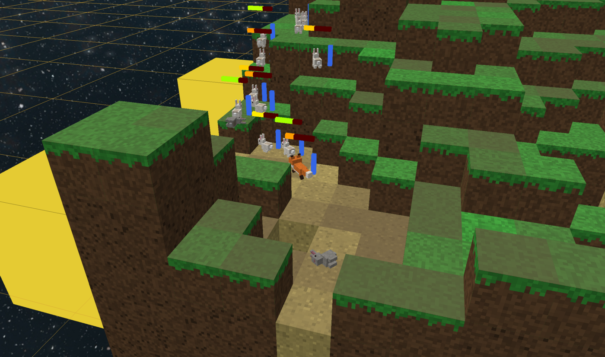
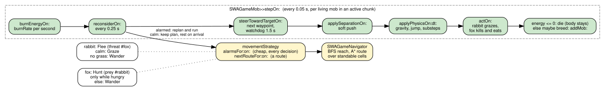

# 7 Mobs: State, Energy, Bodies, Physics

[Deck](index.md) | [1 Architecture](architecture.md) | [2 Terrain](terrain.md) | [3 Chunks](chunks.md) | [4 Rendering](rendering.md) | [5 Picking](picking.md) | [6 Editing](editing.md) | **7 Mobs** | [8 Behaviour](behaviour.md) | [9 Ecosystem](ecosystem.md) | [10 Mob Rendering](mob-rendering.md) | [11 First Person](first-person.md) | [12 Panels](panels.md) | [13 Save and Load](save-load.md) | [14 Tests](tests.md) | [15 Findings](findings.md)

Mark set: [marks/07-mobs.json](marks/07-mobs.json)



A **mob** (`SWAGameMob`, Minecraft's word) is a rabbit (`SWAGameRabbit`) or a
fox (`SWAGameFox`). It lives in the simulation, in cell units, and knows
nothing about rendering; how it looks is the business of `SWAGameMobModel`,
`SWAGameMobGait` and `SWAGameMobRenderer` (see [the animals](../README.md#the-animals)).

## 7.1 State

| what | instance variables | unit |
|---|---|---|
| position, velocity | `x y z`, `vx vy vz`, `onGround` | cells, cells per second; `y` up, `x`/`z` continuous |
| energy | `energy`, `maxEnergy` | arbitrary units; dies at 0 |
| life | `alive`, `age`, `lifespan`, `remains`, `deathTimer` | `age`, `lifespan` and `deathTimer` in seconds; `remains` 1 to 0 |
| where it is kept | `chunkKey` | the chunk bucket it sits in ([Chunks](chunks.md)) |
| what it does | `movementStrategy`, `target`, `route`, `alarmed`, timers, `meal` | see [Behaviour](behaviour.md) |
| parameters | `walkSpeed runSpeed burnRate eatGain eatTime restTime reproduce* offspringEnergy startingEnergy huntRadius territoryRadius lifespan` | per second where it is a rate |

A mob is **not** in a grid cell. `cellX`, `cellY`, `cellZ` floor the position;
`cell` answers `cellX @ cellZ`, the column the grass and height maps are indexed
by.

## 7.2 Update per tick



`SWAGameWorld>>tick` calls `stepOn:` on every mob in an active chunk.
`stepOn:` is the fixed sequence, and the species override the hooks:

1. A dead mob only lies there (`lieOn:`), see *Bodies* below.
2. `age` goes up by the tick period, in seconds.
3. `burnEnergyOn:`: `burnRate` per **second**, scaled by the tick period.
   Per tick it once depended on the tick period, so changing the simulation
   rate silently starved everything.
4. `reconsiderOn:`: the decision, every 0.25 s ([Behaviour](behaviour.md)).
5. Eating mobs stand still; the others steer towards their next waypoint.
6. `applySeparationOn:`, then `applyPhysicsOn:dt:`.
7. `actOn:`: a rabbit grazes, a fox kills or eats.
8. Energy at or below 0: the death is tallied as *starved* and the mob dies.
9. Still alive and `canReproduceOn:` says yes: `makeOffspring` goes into the
   world's newborn queue (`addMob:`).

The world adds the newborns and removes the gone **after** all mobs have
stepped (`harvestDeadAndNewborn`), so no bucket changes while it is iterated.

## 7.3 Physics

Mobs fall, jump and collide against the same voxel store the terrain is meshed
from (`SWAGameWorld>>isSolidAtX:y:z:`).

- **The box** is 0.6 cells wide (`halfWidth` 0.3) and 0.8 high (`height`), so
  a mob fits through a one-block gap and into a one-block tunnel. Its top edge
  is pulled in by 0.001, or a mob standing exactly on a block boundary reports
  the block above its head as a collision.
- **One axis at a time** (`integrateOn:dt:`): x, then z, then y. A blocked
  horizontal move triggers `tryJump`; gravity (24 cells/s²) is applied every
  step and `onGround` is rediscovered by the vertical sweep, so digging out
  the block under a mob drops it.
- **Jumping is how mobs climb.** `jumpSpeed` 7 clears one block
  (7² / (2 · 24) is just above 1), so a one-block rise needs no separate
  step-up case. Two blocks are never cleared; routes go round them
  ([Behaviour](behaviour.md)).
- **Substeps**: speeds are preferences, so one tick can be asked to move
  several cells. Past about a quarter cell per step a mob tunnels into terrain
  and jams, so `applyPhysicsOn:dt:` splits the tick. Measured when introduced:
  at speed 50 a mob travelled 0 cells without substeps, 7 with them.
- **Fast path**: a mob standing still on solid ground (resting or eating, which
  is most of a calm herd) skips the sweep; the block underfoot is still
  checked. Physics went from 21 to 8 µs per mob and tick.

## 7.4 Separation

Mobs may share a block; they just shove each other out of it, softly,
horizontally and mutually, as in Minecraft (`applySeparationOn:`). A hard
block would wedge them in doorways and let a crowd trap one of its own against
a wall.

- Neighbours come from the world's per-cell index (`mobsNearCellX:z:do:`, the
  nine columns around the mob), never from a scan of all mobs.
- The push grows with the overlap of the two 0.6-cell circles and is at most
  `pushStrength`, 80 % of the walk speed, so a shove nudges a mob aside without
  overriding where it is heading.
- Offspring start exactly on the parent. With no direction to push along, a
  random one breaks the tie.

Measured on 20 rabbits piled on one spot: mean distance between pairs 0, then
1.11, then 2.59 cells after the push settled.

## 7.5 Energy

- **Burn**: `burnRate` per second, always, even standing still.
- **Gain**: through eating only, capped at `maxEnergy`. Uncapped, one good
  meal funded a whole run of offspring.
- **Starving**: energy at 0 kills. `SWAGameWorld>>deathTally` keeps
  `#eaten` and `#starved` apart, which is how the early population crashes
  turned out to be starvation, not predation (eaten 53, starved 215).

## 7.6 Bodies

Every death leaves a **body** where the mob fell (`die`): `alive` false,
`remains` 1.0, velocity zeroed, plans dropped.

- A body still falls (`lieOn:` keeps the physics), so a mob killed in mid-jump
  does not hang in the air.
- Foxes eat bodies of their prey (`consume:`, see [Behaviour](behaviour.md));
  `remains` goes down to 0.
- A body is **gone** (`isGone`) when it is eaten or has lain for `decayTime`
  (30 s); the next harvest removes it.
- Bodies are not mobs for counting: `mobsDo:`, the species index and the
  population graph see only the living. `corpsesDo:` and the corpse index
  (`corpsesOfSpecies:`) see the bodies. They are food, never neighbours to
  push against.
- A saved game keeps bodies with their remains and age (`lieDeadWith:after:`).

## 7.7 Adding mobs to a world

`SWAGameWorld>>speciesRegistry` maps `#rabbit` and `#fox` to their classes; a
new species starts there.

- `newMobOfSpecies:` makes one with this game's parameters and starting energy.
- `addMobNow:` is the only way in **outside** a tick (spawn tools, loading,
  initial population). Adding a mob anywhere else once put it on screen but in
  no chunk, so it was drawn and never simulated.
- Inside a tick, newborns are queued (`addMob:`) and placed by the harvest.
- Every way in goes through `configureMob:`: the game's parameters overwrite
  the class defaults the mob was created with (see [Ecosystem](ecosystem.md)).

## 7.8 Age

`age` counts **seconds**, like every rate in the simulation, and is measured
against `lifespan`, a preference per species (rabbit 300 s, fox 600 s).

- **Childhood** (`isChild`): the first 20 % of the lifespan. A child is drawn
  at 0.6 size and its age bar is coloured as young.
- **Growth** (`weight`): from 0.1 at birth to 1 at half the lifespan, linearly.
  A body keeps the weight it died with, since a body stops ageing. A fox gains
  `eatGain × weight` from a whole rabbit, in `eatTime × weight`
  ([Behaviour](behaviour.md)), so a newborn is a tenth of a meal.
- The age bar is full at the end of the lifespan.
- There is **no dying of old age** yet: `lifespan` only sets the pace of
  growing up. Children can breed as soon as their energy allows.

## 7.9 Example

```smalltalk
| w r |
w := SWAGameWorld gridSize: 16 maxHeight: 10.
w ensureVoxels.                  "without it nothing is solid, and mobs fall for ever"
r := w addMobNow: ((w newMobOfSpecies: #rabbit) positionX: 8.5 y: 12 z: 8.5; yourself).
20 timesRepeat: [w tick].
{r y. r onGround. r energy}.     "#(5 true 41.3): landed on the column top, already grazing"
```
