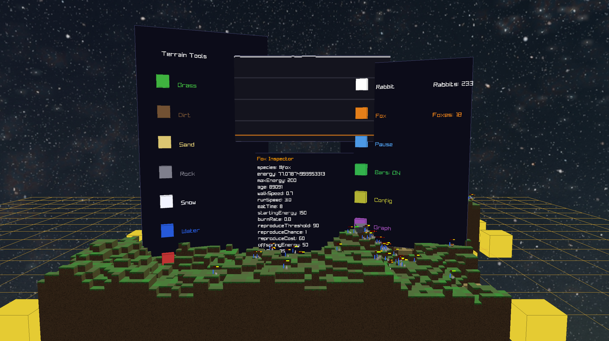

# 12 Panels and Menus: App Menu, Settings, Graph, Inspector

[Deck](index.md) | [1 Architecture](architecture.md) | [2 Terrain](terrain.md) | [3 Chunks](chunks.md) | [4 Rendering](rendering.md) | [5 Picking](picking.md) | [6 Editing](editing.md) | [7 Mobs](mobs.md) | [8 Behaviour](behaviour.md) | [9 Ecosystem](ecosystem.md) | [10 Mob Rendering](mob-rendering.md) | [11 First Person](first-person.md) | **12 Panels** | [13 Save and Load](save-load.md) | [14 Tests](tests.md) | [15 Findings](findings.md)

Mark set: [marks/12-panels-and-menus.json](marks/12-panels-and-menus.json)

The game is controlled through SqueakXR menus and through panels in the
scene. There is also one Morphic window, for tuning without a headset.

## 12.1 Opening a game

World menu > games > **SWAGame** (`SWAGameXR class>>xrMenuSpawn:`, an
`<xrMenu:>` pragma). The new game:

- stands on the floor ahead of the viewer, half the board plus 70 cm away
  (`spawnDistance`); the direction is flattened, so looking down does not pull
  it in;
- is turned in quarter turns, so the grid is square to the room, plus a half
  turn because the game's `+z` runs away from the viewer;
- generates its first 3 x 3 chunks (`generateWorld`), with no panels open.

`isApp` makes it an application in SqueakXR terms: B opens its own menu.

## 12.2 The game's menu

`addCustomMenuItemsTo:` fills the game's context menu:

| row | contents |
|---|---|
| settings > | the toggles below |
| scenarios > | built-in and saved scenarios, image defaults, save current ([Ecosystem](ecosystem.md)) |
| game > | save game, load a saved one ([Save and Load](save-load.md)) |
| tool rows | bare hand, pick axe, materials, species ([Terrain Editing](editing.md)) |

Before filling it, `reconcilePanels` brings the flags in line with the panels:
a panel removed with the halo's Remove never passes through the toggles, so the
flag would still claim it was open.

**Settings** (`addSettingItemsTo:`): Buttons, Graph, Terrain tools, Energy
bars, Simulation running/paused, Chunk bounds, First person, Block outlines,
Block textures, Animal models, Locomotion. Every row is a toggle that keeps the
menu open, and its label is a block, so it shows the current state while the
menu stays in front of the player. The last four are image preferences, the
others belong to this game.

## 12.3 Slabs

A panel is an `SWAGameSlab`: a dark box with a wire frame, carrying buttons and
labels as children.

- Its **face is local +y** and the rows run along local z. A slab lying at the
  table looks at the sky; standing it up needs a quarter turn about x
  (`facingFrom:toward:`).
- It has a collision box, so a ray clicks and grabs it, but `isSolid` is
  false: the walking body does not stand on it.
- `lockPanelChildrenOf:` makes the slab the grab target of its buttons, so
  grabbing a button carries the panel instead of pulling the button off.
- Sizes are in panel units (`panelScale`, 5 cm): buttons are 10 cm cubes, the
  button slab 1.1 m by 1.6 m.
- Slabs are **world** children, not children of the game, so they neither
  follow it nor go with it: `remove` calls `removePanels`.

| panel | built by | contents |
|---|---|---|
| button slab | `createButtonSlab` | select rabbit or fox for clicking into the terrain, population counts, pause, bars, config window, graph |
| tool slab | `createToolSlab` | the six materials and the pick axe, for terrain clicks |
| graph | `toggleGraph` | `SWAGamePopGraph` |
| inspector | `createInspector`, on first inspect | `SWAGameMobInspector` |

A button (`SWAGameButton`) is a coloured cube with an action block, drawn with
a yellow wire frame when `selected`.

## 12.4 Where panels appear

| situation | method | where |
|---|---|---|
| at the table, created | `placeNewPanel:atSide:z:` -> `panelAnchorAtSide:z:` | beside the board, `+x` or `-x`, 60 cm up, lying flat |
| opened from the menu | `placePanel:besideMenu:` | beside the menu, facing the player |
| walk mode, created | `placeNewPanel:atSide:z:` | 60 cm ahead, 45 cm aside, 20 cm down |
| entering walk mode | `bringPanelsToHand:` | at the right hand |
| leaving walk mode | `repositionPanelsAtTable` | back beside the board |

The screenshot above was arranged by hand with `placePanel:at:`, as the menu
does.

## 12.5 Population graph

`SWAGamePopGraph`: the last 200 samples of the rabbit (white) and fox (orange)
counts, drawn into a 200 x 100 Form and shown on an `SWAGameDisplayPlane`
(no collision, so the ray reaches the slab).

- `samplePopulations` feeds it once per tick, also with the button slab
  closed (`testTheGraphIsFedWithTheButtonSlabClosed`): the readout once only ran
  with the slab open, and the graph recorded nothing.
- Redrawn only when a sample came in (`dirty`), at the next frame.
- Forms are BGRA; the `morphicPanel` shader swizzles them back.
- The y axis is scaled to the largest count in the history, at least 10.

## 12.6 Mob inspector

Clicking a mob with the bare hand (no tool, no slab tool) selects it
(`inspectMob:`): a yellow box round it and an `SWAGameMobInspector` slab
listing 17 properties, refreshed every tick. Clicking it again deselects; a mob
that dies is deselected. The inspector is created on the first selection, so a
game starts without it.

Age and lifespan are in seconds; weight runs from 0 to 1 ([Mobs](mobs.md)).

## 12.7 Morphic config window

`SWAGameConfigPanel open` (also the *Config* button) is a Morphic window with a
slider and a number field per species parameter: walk and run speed, rest and
eat time, energies, burn rate, reproduction, eat gain, hunt and territory
radius, detection range.

- It edits the **image defaults** (the class-side preferences), not a game's
  own parameters ([Ecosystem](ecosystem.md)).
- The sliders and fields are wired by name: `get_SWAGameFox_walkSpeed`,
  `set_...:`, `txt_...`, `acc_...:` are answered in `doesNotUnderstand:`.
- *Scenarios...* applies a scenario to the image defaults or saves the current
  ones.

## 12.8 Known problems

- `panelAnchorAtSide:z:` measures from the original 48-cell board. After the
  world has grown, the `-x` tool slab stands over terrain.
- At the table the slabs lie flat, so their text reads upright only from the
  board side.
- `createButtonSlab` is 1380 bytes, close to the ARM JIT hazard of
  [Picking](picking.md); the six rows are written out one by one.
- The *Generate* label of the chunk markers is set and never drawn.

See [Findings](findings.md).
