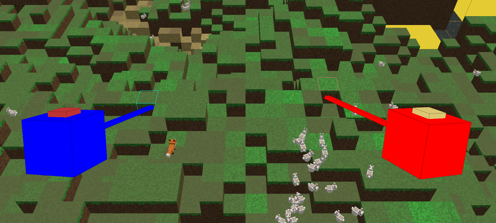

# 5 Picking: Voxel Collider, Ray Walk, Hand Targets

[Deck](index.md) | [1 Architecture](architecture.md) | [2 Terrain](terrain.md) | [3 Chunks](chunks.md) | [4 Rendering](rendering.md) | **5 Picking** | [6 Editing](editing.md) | [7 Mobs](mobs.md) | [8 Behaviour](behaviour.md) | [9 Ecosystem](ecosystem.md) | [10 Mob Rendering](mob-rendering.md) | [11 First Person](first-person.md) | [12 Panels](panels.md) | [13 Save and Load](save-load.md) | [14 Tests](tests.md) | [15 Findings](findings.md)

Mark set: [marks/05-picking.json](marks/05-picking.json)

Picking answers two questions SqueakXR asks every scene object: *where does
this ray hit you?* (hand rays, clicks) and *does this box overlap you?* (the
walking body). For the terrain both are answered from the voxel store
directly, by one collision geometry for the whole world.

## 5.1 One collider for every voxel

`SWAGameXR>>collisionGeometry` answers one `SWAGameVoxelCollider`
(an `SRCollisionGeometry`).

Before it, every column had its own tile with an `SRCollisionBox`. A ray then
tested width x depth boxes, and only the top block of each column: the wall of
a hole you had just dug could not be clicked. The collider marches the ray
through the grid instead, which costs as much as the ray is long, not as much
as the world is big, and is exact on all six faces of every voxel.

## 5.2 The ray walk

`SWAGameVoxelCollider>>voxelHitForRay:` creates a `SWAGameVoxelRayWalk` and
asks it for `findHit`. The walk is a 3D DDA (Amanatides and Woo):

1. **Into cell space** (`setGame:ray:`): world to game-local with the game's
   transform, then divided by `worldScale` and shifted by half the original
   grid, where object space has its origin.
2. **Clip to the march box** (`clipToGrid`): a slab clip against the box of
   all generated chunks (`SWAGameXR>>marchBounds`, which grows in both
   directions) and 0 to `gridHeight` vertically. The clip also tells which
   face the ray entered through.
3. **March** (`prepareStepping`, `march`, `stepToNextVoxel`): voxel by voxel
   over the nearest boundary, until a solid voxel, the box exit, or a step
   bound (the longest path through the box). The axis stepped along is the
   face entered.
4. **Answer** `{gx. gy. gz. faceNormal. gridEntryPoint}` (`hitResult`).

An untracked controller gives a zero direction, which `normalized` turns into
NaN; every comparison with NaN is false, so it would slip through the clip and
fail much later at `floor`. `hasUsableRay` rejects it: such a ray hits nothing.

**Keep these methods small.** The walk was once one method of 1552 bytes and 40
temporaries. Cog's ARM64 JIT miscompiled it, and merely calling it crashed
SqueakXR on the Quest with a SIGSEGV, even with the body reduced to `^ nil`
(journal 2026-07-29). Splitting it into an object with small methods fixed it.

## 5.3 Getting the face back to the game

`rayIntersection:` returns an `SRRayIntersectionResult` with the object (the
game) and the global hit point. The voxel and the face travel separately, by
`SWAGameXR>>noteVoxelHitX:y:z:face:` into `lastVoxelHit`: `SRHand` rebuilds
the result as an `SRHandRayIntersectionResult` and copies only `object` and
`point`, so anything hung on the result would be lost.

`lastVoxelHit` is therefore valid only right after a cast that hit the game.
`SWAGameXR>>onRaycast:` (a bare-hand click) and `SWAGameTool>>handleRaycast:`
([Terrain Editing](editing.md)) read it straight away, and the tool first
checks that the hit object is the game.

## 5.4 The body sweep

`intersectsBoxCenter:halfExtents:` is how the avatar's body (and anything else
that sweeps a box) finds the terrain solid:

- The two corners of the box are converted to cell positions, and every cell
  in between is asked `SWAGameWorld>>isSolidAtX:y:z:`. One collision box per
  voxel would be millions of objects for the few cells a body touches.
- **Corner order is not kept by the game's rotation**: after a half turn the
  low corner maps to the high cell, and `to:do:` iterates nothing. The terrain
  silently stopped holding the player up. Min and max per axis fix it; game
  yaws are snapped to quarter turns, so the two corners still bound the cells
  (tests `testTheTerrainIsSolidToTheBoxSweep...`).
- Ungenerated chunks count as solid ([Chunks](chunks.md)), so the walker
  cannot fall off the edge of the world.

## 5.5 Hand targets

Every frame, also while the simulation is paused, `updateHandTargets` asks for
each hand which voxel it points at (`targetVoxelFor:`), and
`renderHandTargetsOn:` draws a wire box round it:

- The cast goes against the **whole scene** (`castNearest: self world`), not
  only the terrain: with a menu or panel in the way a tool would decline, and
  the mark has to go away too.
- Not gated on holding a tool: the box is how you see where a hand aims before
  arming it.
- In the hand's ray colour, not the tool's: a rabbit spawn tool is white, which
  was indistinguishable from no colour.
- 1.04 cells, slightly oversized, or it z-fights with the block faces.
- The dictionary is reused, the slot set to nil instead of removed, so it is
  not reallocated every frame.

This is a second cast per hand and frame, on top of the one `SRHand` makes
for its own ray.

## 5.6 Other things a ray can hit

| object | collision | note |
|---|---|---|
| `SWAGameButton` | `SRCollisionBox` | `onRaycast:` runs its action; `isSolid` false, so it is not a floor |
| `SWAGameSlab` and subclasses | `SRCollisionBox` | clicked and grabbed; `isSolid` false |
| `SWAGameDisplayPlane` | none | the graph's picture, so the ray reaches the slab behind |
| `SWAGameBasePlate` | the plane's | `grabTarget` is the game |
| chunk markers (`SWAGameButton`) | box | `grabTarget` is the game |

The game itself refuses to be dragged (`dragTo:` is empty): at table scale a
grab aimed at a block knocked the board askew, and standing in it, dragging
moved the ground from under you. Grabbing is still how a hand selects the
game, so its context menu opens.

## 5.7 Tests

In `SWAGameXRMappingTest`: `testPickingReachesChunksAtNegativeCoordinates`,
`testPickingStopsAtUngeneratedChunks`,
`testVoxelHitPointLandsOnTheColumnSurface`, `testEachHandTargetsItsOwnVoxel`,
and the two box sweep tests.
