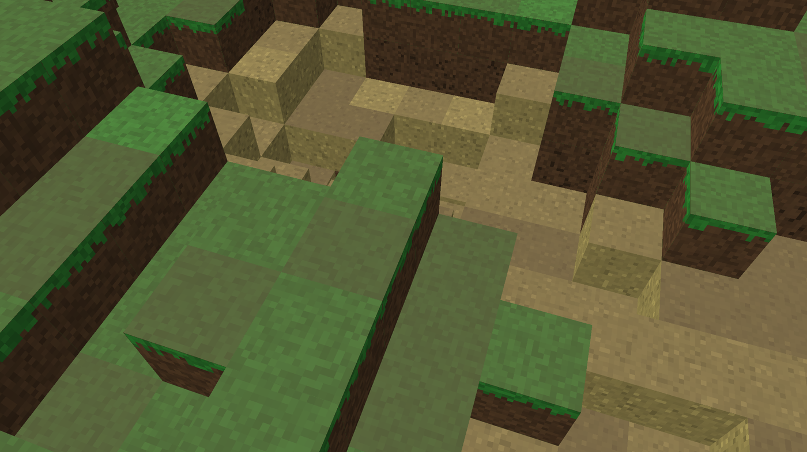
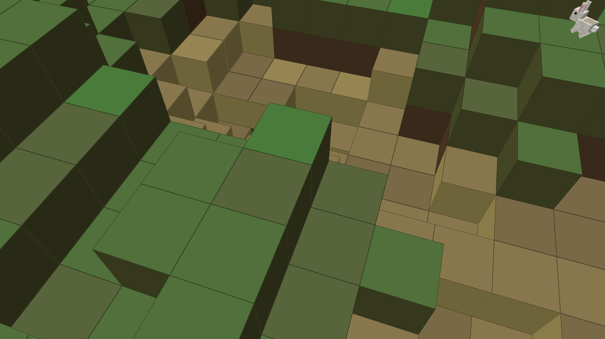

# 4 Terrain Rendering: Block Patterns, Grass Map, Outlines

[Deck](index.md) | [1 Architecture](architecture.md) | [2 Terrain](terrain.md) | [3 Chunks](chunks.md) | **4 Rendering** | [5 Picking](picking.md) | [6 Editing](editing.md) | [7 Mobs](mobs.md) | [8 Behaviour](behaviour.md) | [9 Ecosystem](ecosystem.md) | [10 Mob Rendering](mob-rendering.md) | [11 First Person](first-person.md) | [12 Panels](panels.md) | [13 Save and Load](save-load.md) | [14 Tests](tests.md) | [15 Findings](findings.md)

Mark set: [marks/04-terrain-rendering.json](marks/04-terrain-rendering.json)

The terrain is drawn by one shader, `swagameTerrain`
(`SWAGameXR class>>swagameTerrain`, a `<shaderSource:>` method), over the
chunk meshes of [Chunks](chunks.md). Everything that makes a block look like a
block is computed per pixel in that shader: there are no textures for blocks.

## 4.1 What the shader gets

| input | from | used for |
|---|---|---|
| vertex position, normal, texcoord | the chunk mesh (`SWAGameVoxelChunks`) | cell and face; texcoords 0..1 across each face for the outline |
| vertex colour rgb | block colour (`SWAGameBlocks`) | base colour |
| vertex colour **alpha** | the block **id** | which pattern to draw |
| `lineThickness` | `effectiveLineThickness` | outline width in pixels, 0 = off |
| `blockTextures` | preference, 1.0 or 0.0 | pattern on or off |
| `worldScale`, `gridExtent` | `setGrassUniformsOn:` | inverting the cell mapping, see 4.4 |
| `grassMap` | `ensureGrassTexture` | grass level per column |

`mvp`, `matNormal` and `colDiffuse` are set by raylib's `DrawMesh`.
`setVoxelUniforms` writes the rest once per frame, through one reused 4-byte
buffer (`setShaderFloat:at:on:`).

## 4.2 Block id in the vertex colour

A voxel is one byte, its block id ([Terrain](terrain.md)). The mesher writes
the id into the alpha channel of every vertex of the block
(`SWAGameBlocks class>>rgbaFor:`, test `testTheBlockTypeTravelsInAlpha`). The
shader reads it back as `int(fragColor.a * 255.0 + 0.5)`. So the pattern needs
neither a texture atlas nor an extra vertex attribute.

## 4.3 Block patterns

`blockPattern()` draws 16 x 16 pixels per face, like a Minecraft texture:

- The pixel grid is the cell position times 16, taken half a pixel inside the
  face, so a pixel belongs to this block and not its neighbour.
- Each pixel gets a hash of its integer position (`rnd`), so the pattern is
  stable and needs no storage.
- Per type: grass tops are speckled green; grass **sides** are dirt with the
  green hanging two to four pixels over the edge (per pixel column); sand has
  dark specks; rock is a grey with darker blotches at half resolution; snow is
  nearly flat; water has vertical streaks; dirt is speckled brown.
- **Far away the pattern fades out.** Once a block pixel is smaller than a
  screen pixel (`fwidth` of the pixel coordinate above 0.7 to 1.5) the pattern
  only shimmers, as on the table at 5 cm per block. There the colour fades to
  the block's average.

## 4.4 Grass map

Grazing changes the colour of the grass. That is not baked into the mesh:
grass changes a few hundred times a second, and baking it would keep every
chunk dirty. Instead the levels go into a **texture of one pixel per column**
(`grassSource`, an `SRTextureSourceForm`, uploaded as `grassTexture`).

- `updateGrassTexture` runs every frame, writes straight into the Form's words
  (a canvas fill would composite) and only touches columns whose shade changed;
  the upload is skipped when nothing changed.
- Six shades only (`grassShadeCount`), level 0 meaning "not grassland".
- **Green and alpha carry the data** (`grassWordForLevel:`): a Form is ARGB
  and arrives on the GPU as BGRA, and those are the two channels the red/blue
  swap leaves alone (test `testGrassIsEncodedInGreenAndAlphaOnly`).
- The shader turns the object position back into a cell with `worldScale` and
  `gridExtent`, which must match the mesher's mapping (`SWAGameSpace`). It
  samples **at the texel centre**: the texture is bilinear, and sampling the
  continuous position bled pasture colour onto the water next to it.
- Only upward faces are tinted, faded in by the normal so a slightly tilted
  normal does not pop. Grazed ground fades towards bare earth, mixed with the
  block's own colour so the height palette survives.

The grass map is sized from `world gridSize`, the original 48 x 48 cells.
Chunks generated later are not tinted. See [Findings](findings.md).

## 4.5 Outlines

An outline is drawn round every face from the face texcoords: `fwidth`
converts the distance to the face border into screen pixels, so the line is
`lineThickness` pixels wide at any distance. No viewport size is needed,
and stereo is right per eye. The outline colour is half the base colour.

Preference **Block outlines** (off by default) switches it; off sends
`lineThickness` 0 (`effectiveLineThickness`, test
`testOutlinesOffMeansAZeroWidthLine`). `lineThickness:` sets the width,
default 2 pixels; it is a uniform, so no remesh.

## 4.6 Light

One fixed directional light, `(0.5, -1, -0.25)`, with 0.4 ambient. Without the
ambient, the sides turned away from the light went black and lost their
pattern. The mob shader uses the same light with more ambient
([Mob Rendering](mob-rendering.md)).

## 4.7 Drawing

`renderTerrainMeshOn:`, first thing in `SWAGameXR>>renderOn:`:

1. `rebuildUpTo: chunkRebuildBudget`: at most two chunk meshes rebuilt per frame.
2. `ensureVoxelMeshMaterial`: one `SRMaterial` with the shader.
3. Grass texture, uniforms, the game's transform into a reused `RlMatrix`.
4. Every chunk mesh with that one material and transform, **without back-face
   culling**.

Terrain goes first because `drawMesh` replaces the current matrix that the
mob pass pushes ([Architecture](architecture.md)).

## 4.8 When the shader is missing

On the Quest there is no GLSL transpiler: the shader must already be in the
`ShaderCache`. `ensureVoxelMeshMaterial` then falls back to a plain
`SRMaterial` (flat colours) and says so on the Transcript; a shader that fails
to compile does the same. After a lost GL context
(`onCacheInvalidated`) the material, meshes and grass texture upload again.

## 4.9 Preferences

| preference | default | effect |
|---|---|---|
| Block textures | on | the patterns of 4.3 |
| Block outlines | off | the lines of 4.5 |

Both are image preferences, shown in the game's settings submenu
([Panels and Menus](panels.md)), so they apply to every game.
