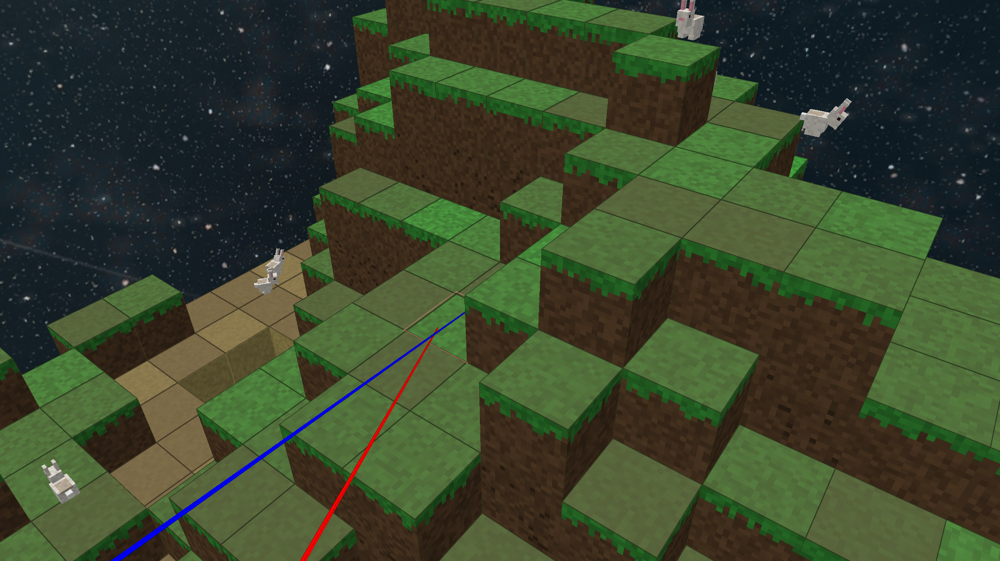

# 2 Terrain Generation

[Deck](index.md) | [1 Architecture](architecture.md) | **2 Terrain** | [3 Chunks](chunks.md) | [4 Rendering](rendering.md) | [5 Picking](picking.md) | [6 Editing](editing.md) | [7 Mobs](mobs.md) | [8 Behaviour](behaviour.md) | [9 Ecosystem](ecosystem.md) | [10 Mob Rendering](mob-rendering.md) | [11 First Person](first-person.md) | [12 Panels](panels.md) | [13 Save and Load](save-load.md) | [14 Tests](tests.md) | [15 Findings](findings.md)

Mark set: [marks/02-terrain-generation.json](marks/02-terrain-generation.json)



## 2.1 The pipeline

```
SWAPerlinNoise  -->  height per column  -->  grass per column  -->  block type per cell  -->  voxel store  -->  mesh
 (one per world)     heightForColumnX:z:     isGrasslandAtX:z:      blockTypeAtX:z:y:       fillChunkVoxels   (Chunks page)
                     \________________ SWAGameWorld, per chunk ________________/            SWAGameXR
```

Generation is **per chunk** (16 x 16 columns), and there is exactly one path:
`SWAGameWorld>>initializeWithGridSize:maxHeight:` generates the starting area
chunk by chunk with the same `generateChunkAtX:z:` that later raises a chunk
when a marker is clicked. A whole-world pass and a per-chunk pass would sooner
or later disagree.

## 2.2 Height from noise

`heightForColumnX:z:` asks `SWAPerlinNoise` for fractal noise at the column's
position and maps it to a height:

```smalltalk
value := self noise octaveNoiseX: x * 0.08 y: z * 0.08 octaves: 4 persistence: 0.5.
^ ((value + 1) / 2 * maxHeight) rounded max: 1
```

- `SWAPerlinNoise` is classic 2D Perlin noise: a 256-entry permutation
  (stored twice, so lookups never wrap), four gradient directions, the quintic
  fade `6t^5 - 15t^4 + 10t^3`. `noiseX:y:` answers -1 to 1.
  `octaveNoiseX:y:octaves:persistence:` is fractal Brownian motion: each octave
  doubles the frequency and multiplies the amplitude by the persistence.
- 0.08 per cell gives hills about a dozen cells across, 4 octaves of detail.
- `maxHeight` is 20 for a new game; the voxel store is 32 high, which leaves
  12 blocks of headroom for building. `resizeToGrid:height:` keeps that ratio
  at two thirds.

Because the height depends **only on the column's world position**, two
neighbouring chunks compute their shared edge from the same coordinates, and
chunks join without seams in whatever order they are generated. Generation is
also idempotent: a chunk that exists is not generated again.

The one precondition is **one noise instance per world**
(`SWAGameWorld>>noise`). `SWAPerlinNoise>>initialize` shuffles its
permutation, so a chunk generated against a second instance would not line up
with its neighbours at all. A saved game stores the 256 permutation bytes, and
loading rebuilds the noise from them, so a loaded world keeps growing the
same landscape.

## 2.3 Height and grass storage

Heights and grass levels are kept **per chunk**, as 256-byte `ByteArray`s in
`heightMap` and `grassMap` (chunk key to bytes). The slot of a column is
`((x & 15) << 4) + (z & 15) + 1` (`columnIndexX:z:`). Per-chunk storage is what
lets the world grow in any direction without a fixed extent; bytes instead of
the nested Arrays used before take an eighth of the memory.
`compactTerrainMaps` converted old worlds and has no senders now.

Coordinate conventions (inconsistent, see [Findings](findings.md)):

| method | base | note |
|---|---|---|
| `heightAtX:y:`, `heightAtX:y:put:` | **one** based | the second argument is **z**; the name predates `y` meaning up |
| `isGrasslandAtX:z:`, `blockTypeAtX:z:y:` | one based in x and z | note the argument order of the latter: x, z, then y |
| `grassAt:`, `grassAt:put:` | **zero** based | `aPoint` is `x @ z` |
| `columnIndexX:z:` | zero based | |

A column whose chunk was never generated answers height **1**: flat ground,
not a hole.

## 2.4 Block types by elevation

`blockTypeAtX:z:y:` decides per cell, with `ratio = (h - 1) / (maxHeight - 1)`
of the column's surface:

| below the surface | ratio <= 0.2 | <= 0.35 | <= 0.7 | <= 0.85 | above |
|---|---|---|---|---|---|
| dirt | water | sand | grass | rock | snow |

Only the top cell of a column gets the surface type; everything below it is
dirt. Water is an ordinary solid block on the surface of low columns: it does
not flow, and mobs and the avatar walk on it.

**Grassland** is the band `0.2 < ratio <= 0.7` (`isGrasslandAtX:z:`). Grass
levels run 0 to `maxGrass` (10); a new chunk starts with every grassland
column at the maximum. Grass is computed *after* the heights of the chunk,
because it depends on the elevation. How grass is eaten and grows back is part
of the ecosystem, not of generation.

## 2.5 Block ids and colours

A voxel holds a **block type id**, one byte (`SWAGameBlocks`):

| id | 0 | 1 | 2 | 3 | 4 | 5 | 6 |
|---|---|---|---|---|---|---|---|
| | air | grass | dirt | sand | rock | snow | water |

`SWAGameBlocks class>>types` is the table (id order, symbol, colour).
`rgbaFor:` answers a memoised four-element array per id, because the mesher
asks for it once per face and must not allocate. Its **alpha is the type id**,
not opacity: the `swagameTerrain` fragment shader picks its pixel pattern by
it, so block patterns need neither a texture nor an extra vertex attribute
(see [the blocks](../README.md#the-blocks) in the introduction).

Before ids, every cube's `Color` sat in a Dictionary keyed by coordinate:
66,104 entries on a 64-cell world, against 131 KB of actual blocks.

## 2.6 From heights to voxels

`SWAGameXR>>fillChunkVoxelsAtX:z:` writes one chunk's columns into the shared
voxel store: for every column, cells `0` to `h - 1` (clamped to the store's
height) get `blockTypeAtX:z:y:`. `generateLevel` does the same for the whole
original area at once (see [Findings](findings.md): it is a second copy).

A headless world without a game raises its own store in
`SWAGameWorld>>ensureVoxels`, all blocks id 1, because mob physics needs
something solid to stand on.

Editing goes the other way: after a dig or a placement,
`syncHeightMapForColumnX:z:` sets the column's height to the top filled block
plus one, so mobs graze and spawn on the surface you can see.

## 2.7 Rivers (unused)

`SWAGameWorld` still has a `riverMap`, `isRiverAt:` and checks for it in
`blockTypeAtX:z:y:`, `SWAGameRabbit>>canEnter:on:` and the grass texture.
Rivers were carved by a whole-world pass after the height map existed.
Since generation is per chunk, **nothing fills `riverMap`** and `isRiverAt:`
always answers false. Flowing water would have to come in through here, or the
remains should go (see [Findings](findings.md)).

## 2.8 Example

```smalltalk
| w |
w := SWAGameWorld gridSize: 32 maxHeight: 20.          "two by two chunks, mobs included"
(1 to: 32) collect: [:x | w heightAtX: x y: 1].        "a row of heights"
w generateChunkAtX: 2 z: 0.                            "true: raised a third chunk"
w generateChunkAtX: 2 z: 0.                            "false: already there"
```
